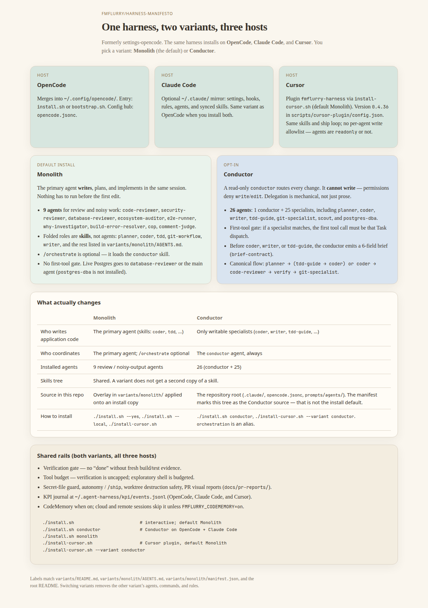
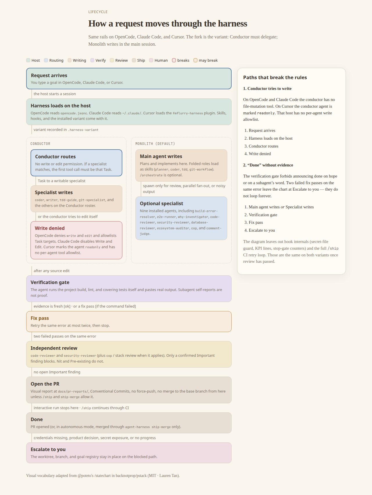

[English](../README.md) | **Français**

<p align="center">
  <a href="https://github.com/fmflurry/code-memory"></a>
  <a href="../LICENSE"></a>
  <a href="https://opencode.ai"></a>
  <a href="https://claude.com/claude-code"></a>
  <a href="https://cursor.com"></a>
</p>

# harness-manifesto

Un harness pour **Claude Code**, **OpenCode** et **Cursor**. Anciennement [settings-opencode](https://github.com/fmflurry/settings-opencode) ; cette URL redirige ici. On installe une variante. **Monolith** est le défaut. **Conductor** est opt-in. Les skills forment un seul arbre partagé dans les deux cas.

Licence MIT. Forkez-le. L'arbre suit le workflow, donc traitez-le comme une référence vivante.

Un harness pour **Claude Code**, **OpenCode** et **Cursor**. Anciennement settings-opencode. **Monolith** est le défaut, **Conductor** est opt-in. Les schémas sont en anglais et partagés. [Choisir une variante](#variantes-fr) et [Comment une demande avance](#parcours-fr) reprennent le même choix en français. L'installation est dans [Installation publique](#public-install).

<a id="variants"></a>

## Un harness, deux variantes, trois hôtes

<p align="center">
  <a href="harness/monolith-vs-conductor.html"></a>
</p>

[Ouvrir la comparaison](harness/monolith-vs-conductor.html) (un fichier HTML, sans réseau). [La même page en français, plus bas](#variantes-fr).

Trois hôtes, un seul arbre d'installation :

| Hôte | Où ça atterrit |
| --- | --- |
| OpenCode | `~/.config/opencode/`. Fichier pivot : `opencode.jsonc`. Entrée : `install.sh` ou `bootstrap.sh`. |
| Claude Code | Miroir optionnel `~/.claude/` : settings, hooks, rules, agents, skills synchronisés. Même variante qu'OpenCode quand les deux sont installés. |
| Cursor | Plugin `fmflurry-harness` via `install-cursor.sh`. Version **0.4.36** dans `scripts/cursor-plugin/config.json`. Les agents sont marqués `readonly` ou non. Cet hôte n'a pas de liste d'écriture par agent. |

**Monolith** est `variants/monolith/`. Ces commandes l'installent quand la variante est omise : `./install.sh --yes`, `./install.sh --local`, `bootstrap.ps1`, `settings-sync` et `./install-cursor.sh`. `install.sh` copie l'arbre Conductor, puis `scripts/variants/apply-monolith.mjs` superpose le roster allégé sur cette copie. Le checkout source reste tel quel.

L'agent principal écrit, planifie et implémente dans la même session. Rien n'a à tourner avant la première édition. `/orchestrate` charge le skill `conductor` et reste optionnel.

Neuf agents sont installés, pour la revue et la sortie bruyante : `code-reviewer`, `security-reviewer`, `database-reviewer`, `ecosystem-auditor`, `e2e-runner`, `why-investigator`, `build-error-resolver`, `cop`, `comment-judge`. Les rôles repliés sont des skills (`planner`, `coder`, `tdd`, `git-workflow`, `writer`, et le reste nommé dans `variants/monolith/AGENTS.md`). Postgres en direct va à `database-reviewer` ou à l'agent principal. Le roster installé laisse de côté `postgres-dba`.

**Conductor** est la racine du dépôt : `.claude/`, `opencode.jsonc`, `prompts/agents/`, `instructions/`. `variants/conductor/manifest.json` pose `"default": true` parce que cette racine est la source Conductor. Les installeurs choisissent quand même Monolith quand la variante est omise. Conductor se choisit avec `./install.sh conductor`, `./install-cursor.sh --variant conductor`, ou l'alias `orchestration`.

Un `conductor` en lecture seule route chaque changement. Dans `opencode.jsonc`, ses outils `write` et `edit` sont coupés, et l'allowlist Task nomme chaque spécialiste légal. `instructions/subagent-routing.md` est la porte du premier outil : quand un spécialiste correspond, le premier appel d'outil est ce Task. Avant `coder`, `writer` ou `tdd-guide`, le conducteur émet le brief à 6 champs (`brief-contract`). Le roster fait 1 conducteur plus 25 spécialistes : 26 fichiers dans `prompts/agents/` et 26 dans `.claude/agents/`.

```
planner → (tdd-guide → coder) or coder → code-reviewer → verify → git-specialist
```

Sur Cursor, le même agent conductor est marqué `readonly` (`scripts/cursor-plugin/lib.mjs`). La délégation sur cet hôte, c'est la marque readonly plus le prompt.

Changer de variante retire les agents, commandes et règles de l'autre. Revenir à Conductor lance `scripts/variants/prune-foreign.mjs`.

| | Monolith | Conductor |
| --- | --- | --- |
| Qui écrit le code applicatif | L'agent principal, via des skills tels que `coder` et `tdd` | Les spécialistes qui écrivent (`coder`, `writer`, `tdd-guide`, et les autres noms écrivables dans `instructions/subagent-routing.md`) |
| Qui coordonne | L'agent principal. `/orchestrate` est optionnel | L'agent `conductor` |
| Agents installés | 9 | 26 (conductor + 25) |
| Skills | Arbre `skills/` partagé | Arbre `skills/` partagé |
| Source dans ce dépôt | Overlay `variants/monolith/` sur la copie d'install | Racine du dépôt. `"default": true` marque cette source |
| Installation | `./install.sh --yes`, `./install.sh --local`, `./install-cursor.sh` | `./install.sh conductor`, `./install-cursor.sh --variant conductor`. `orchestration` est un alias |

```bash
./install.sh                         # interactif ; défaut Monolith
./install.sh --yes                   # Monolith sur OpenCode + Claude Code
./install.sh conductor               # Conductor sur OpenCode + Claude Code
./install.sh monolith
./install.sh --local                 # fichiers projet ; défaut Monolith
./install.sh --variant orchestration # alias de Conductor
./install-cursor.sh                  # plugin Cursor, défaut Monolith
./install-cursor.sh --variant conductor
```

Windows : `bootstrap.ps1` sans variante est Monolith. `bootstrap.ps1 conductor` sélectionne Conductor. `orchestration` est le même alias.

<a id="variantes-fr"></a>

### Choisir une variante

Monolith est le défaut : `./install.sh --yes`, `./install.sh --local`, `bootstrap.ps1`, `settings-sync`, `./install-cursor.sh`. L'agent principal écrit, planifie et implémente. Neuf agents restent pour la revue et la sortie bruyante. Les rôles repliés sont des skills, listés dans `variants/monolith/AGENTS.md`. `/orchestrate` charge le skill `conductor` et reste optionnel. Postgres en direct va à `database-reviewer` ou à l'agent principal.

Conductor se choisit avec `./install.sh conductor` ou `./install-cursor.sh --variant conductor`. `orchestration` est un alias. Le conducteur route chaque changement. Le roster fait 1 conducteur + 25 spécialistes. `variants/conductor/manifest.json` porte `"default": true` parce que la racine du dépôt est l'arbre source Conductor. Les installeurs choisissent Monolith quand la variante est omise.

Le schéma au-dessus et la [page HTML](harness/monolith-vs-conductor.html) montrent les trois hôtes et le tableau des différences. Changer de variante retire les agents, commandes et règles de l'autre.

<a id="request-flow"></a>

## Comment une demande avance

<p align="center">
  <a href="harness/request-lifecycle.html"></a>
</p>

[Ouvrir le statechart](harness/request-lifecycle.html). Vocabulaire visuel adapté de `/statechart` de @poteto dans backnotprop/pstack (MIT · Lauren Tan).

Les rails sont les mêmes sur OpenCode, Claude Code et Cursor. La fourche, c'est la variante. Conductor route, et un spécialiste qui écrit modifie. Monolith écrit dans la session principale et lance un spécialiste pour la revue, un éventail parallèle, ou une sortie bruyante. Après une édition de source, la porte de vérification veut le build du projet, le lint, et les tests qui couvrent le changement, avec la sortie réelle collée. Deux passes de correctif en échec sur la même erreur arrêtent. La revue indépendante, c'est `code-reviewer` et `security-reviewer`, plus `cop` ou le reviewer du stack quand il s'applique. Un finding Important confirmé bloque. Nit et Pre-existing ne bloquent pas. Une exécution interactive s'arrête quand la PR est ouverte. `/ship` continue à travers la CI et ne fusionne qu'avec `agent-harness ship-merge`.

Le schéma laisse de côté les internes des hooks et la boucle complète de retry de `/ship`. Ils sont partagés une fois la revue passée. Le contrat est [Mode autonome](#autonomy-en) et [Mode autonome](#autonomy-fr) (la reprise de la section Français).

Partagé par les deux variantes et les trois hôtes :

- Porte de vérification. « Done » attend une sortie de commande fraîche.
- Budget d'outils. Les commandes de vérification ne sont pas plafonnées. Le shell exploratoire est budgété.
- Garde des fichiers secrets, autonomie et `/ship`, sécurité de destruction des worktrees, et un rapport visuel de PR sous `docs/pr-reports/`.
- Journal KPI dans `~/.agent-harness/kpi/events.jsonl`.
- CodeMemory quand il est allumé. Les sessions cloud et distantes le sautent, sauf `FMFLURRY_CODEMEMORY=on`.

<a id="parcours-fr"></a>

### Comment une demande avance

Mêmes rails sur OpenCode, Claude Code et Cursor. Conductor délègue. Monolith écrit dans la session principale. Le schéma et la [page HTML](harness/request-lifecycle.html) suivent la demande : routage ou écriture, porte de vérification, revue, PR, ou escalade vers vous. Le vocabulaire visuel est adapté de `/statechart` de @poteto dans backnotprop/pstack (MIT, Lauren Tan).

## Sur cette page

- [Variantes](#variants) · [Choisir une variante](#variantes-fr)
- [Comment une demande avance](#request-flow) · [Comment une demande avance](#parcours-fr)
- [Installation publique](#public-install)
- [Mesurer les variantes](#measure) · [Mesurer les variantes](#mesurer-fr)
- [Ce qu'il y a dedans](#whats-inside)
- [Anglais](#english) — changements récents, structure, mécanique Conductor, catalogues, [mode autonome](#autonomy-en)
- [Français](#francais) — [mode autonome](#autonomy-fr)

<a id="public-install"></a>

## Installation publique

Le dépôt est prévu pour se fusionner dans `~/.config/opencode/`, plus un miroir optionnel `~/.claude/`. Il y a trois chemins : une **installation en une ligne** (recommandée — rien à cloner à la main), un script unique si vous avez déjà le dépôt, et un pas à pas manuel si vous voulez voir chaque étape.

### Installation en une ligne

Pas besoin de cloner quoi que ce soit d'abord. La commande ci-dessous télécharge [harness-manifesto](https://github.com/fmflurry/harness-manifesto). `bootstrap.sh` clone encore `https://github.com/fmflurry/settings-opencode.git` (cette URL redirige ici) dans `~/.local/share/settings-opencode` (surcharge avec `SETTINGS_OPENCODE_SRC`), puis lance l'installeur. Ce nom de répertoire, et la clôture de shell rc `# >>> settings-opencode >>>`, sont encore ce que `bootstrap.sh` et `install.sh` écrivent. **Relancer exactement la même commande est aussi la mise à jour** — elle tire la dernière version et la réapplique.

**macOS / Linux / WSL** (bash) :

```bash
curl -fsSL https://raw.githubusercontent.com/fmflurry/harness-manifesto/master/bootstrap.sh | bash
```

Sous WSL, l'installation se fait côté **Windows** (`/mnt/c/Users/<you>/.config/opencode`), comme le comportement WSL de `install.sh`. Passez les drapeaux de l'installeur après `-s --` :

```bash
curl -fsSL https://raw.githubusercontent.com/fmflurry/harness-manifesto/master/bootstrap.sh | bash -s -- --local
curl -fsSL https://raw.githubusercontent.com/fmflurry/harness-manifesto/master/bootstrap.sh | bash -s -- --no-claude
curl -fsSL https://raw.githubusercontent.com/fmflurry/harness-manifesto/master/bootstrap.sh | bash -s -- --uninstall
```

**Windows natif** (PowerShell — sans WSL) :

```powershell
irm https://raw.githubusercontent.com/fmflurry/harness-manifesto/master/bootstrap.ps1 | iex
```

Fusionne dans `%USERPROFILE%\.config\opencode` et `\.claude`, lance `npm install` (ou `bun install`), et écrit les défauts `OPENCODE_*` comme **variables d'environnement utilisateur persistantes**. Ouvrez un nouveau terminal ensuite pour qu'elles prennent effet. Variantes :

```powershell
# installation au niveau du projet
& ([scriptblock]::Create((irm https://raw.githubusercontent.com/fmflurry/harness-manifesto/master/bootstrap.ps1))) -Local
# sauter le miroir Claude
& ([scriptblock]::Create((irm https://raw.githubusercontent.com/fmflurry/harness-manifesto/master/bootstrap.ps1))) -NoClaude
# sauter OpenCode (installer Claude seulement)
& ([scriptblock]::Create((irm https://raw.githubusercontent.com/fmflurry/harness-manifesto/master/bootstrap.ps1))) -NoOpencode
# désinstallation (retire les variables OPENCODE_* ; laisse la config copiée en place)
& ([scriptblock]::Create((irm https://raw.githubusercontent.com/fmflurry/harness-manifesto/master/bootstrap.ps1))) -Uninstall
```

### Prérequis

- macOS, Linux, WSL, ou Windows natif.
- [OpenCode CLI](https://opencode.ai) installé et sur le `PATH` (sauf installation de Claude Code seul via `--no-opencode`).
- [Claude Code](https://claude.com/claude-code) installé si vous voulez le miroir `.claude/` (sauf saut via `--no-claude`).
- Soit [Bun](https://bun.sh) (recommandé — `bun.lock` est ce qui est versionné), soit Node.js **>=22.6** avec `npm`.
- `git`.

### Secrets

Ce dépôt ne stocke **aucune clé d'API**. Si vous utilisez le fournisseur `myMistral` dans `opencode.jsonc`, posez `MISTRAL_API_KEY` en :
- copiant `.env.example` → `.env` et en y mettant votre clé, OU
- exportant `MISTRAL_API_KEY` dans votre shell rc.

Les autres fournisseurs (Anthropic, OpenAI, GitHub Copilot, OpenCode Go) ont besoin de leurs propres clés, posées de la même façon si vous sélectionnez leurs profils. Tous les fichiers locaux `.env*` sont git-ignorés ; seul `.env.example` est suivi.

### Installation rapide (script)

Le dépôt est déjà cloné ? Lancez l'installeur directement :

```bash
git clone https://github.com/fmflurry/harness-manifesto.git ~/Workspace/harness-manifesto
cd ~/Workspace/harness-manifesto
./install.sh
```

`install.sh` est interactif par défaut. Il demande quel harness installer (Claude Code, OpenCode, ou les deux), quelle variante (Conductor ou Monolith), et si la portée est globale ou locale. La question de variante vient en premier. Monolith est le défaut. `conductor` sélectionne Conductor :

1. Vérifier les prérequis (`git`, `bun`/`npm`).
2. **OpenCode** (si choisi) : fusionner les fichiers du dépôt dans `~/.config/opencode` (ou `./.opencode` si `--local`) sans retirer la config utilisateur existante.
3. Lancer `bun install` (ou `npm ci` si Bun n'est pas disponible).
4. Synchroniser les skills de l'ensemble canonique vers les deux harnesses via `scripts/sync-skills.sh`.
5. Amorcer les fichiers de config personnelle (`settings.json`, `settings.local.json`, `policy-limits.json`) **seulement à la première install** ; préserver les éditions utilisateur à la réinstall.
6. Ajouter les défauts `OPENCODE_MODEL_*` et `OPENCODE_REASONING_*` au shell rc, encadrés par des marqueurs pour que les relances et les désinstallations soient idempotentes (OpenCode seulement, sauté si `--local`).
7. **Claude Code** (si choisi) : fusionner `.claude/` dans `~/.claude` (ou `./.claude` si `--local`).
8. Afficher une commande de smoke test et les endroits à ajuster ensuite.

Drapeaux utiles :

| Drapeau         | Comportement                                                                                                                                                                                |
| --------------- | ------------------------------------------------------------------------------------------------------------------------------------------------------------------------------------------- |
| _(aucun)_       | Parcours interactif : prompt `[Y/n]` pour OpenCode (défaut Y) et Claude Code (défaut Y).                                                                                                    |
| `--yes`, `-y`   | Non interactif — accepter tous les défauts : OpenCode ✓, Claude Code ✓. Monolith est le défaut, y compris une install globale. Les répertoires normaux existants sont fusionnés, pas retirés ni sauvegardés. |
| `--variant`     | `monolith` (défaut) ou `conductor`. `orchestration` est un alias de `conductor`. Identique à `HARNESS_VARIANT`. Le drapeau l'emporte sur l'env. Sans aucun des deux, Monolith est le défaut, y compris un `--yes` global. `conductor` sélectionne Conductor. |
| `--status`      | Affiche la variante installée pour OpenCode et Claude Code, puis sort. `--local` affiche aussi `./.cursor`, `./.agents`, l'overlay `.harness-local`, les entrées exclude, et l'état domain-rules. Un marqueur `orchestration` est rapporté comme Conductor. |
| `--local`       | Installation au niveau du projet dans le répertoire courant (`./.opencode`, `./.claude` comme frères indépendants) et vendore `./AGENTS.md`, `./.cursor/rules` et `./.agents`. Applique `.harness-local/` par-dessus et élague `.harness-local/exclude`. Saute le bloc d'env global du shell rc (l'affiche comme indication à la place). La variante par défaut est Monolith. |
| `--opencode`    | **Liste d'autorisation :** installer OpenCode seulement (combiné à d'autres drapeaux, seuls ceux-là sont installés).                                                                        |
| `--claude`      | **Liste d'autorisation :** installer Claude Code seulement.                                                                                                                                 |
| `--no-opencode` | **Refus :** sauter OpenCode entièrement (copie du dépôt, dépendances et bloc d'env). Peut se combiner avec d'autres cibles.                                                                 |
| `--no-claude`   | **Refus :** sauter le miroir Claude Code. Peut se combiner avec d'autres cibles.                                                                                                            |
| `--uninstall`   | Retire le bloc de variables d'env et, après confirmation, peut retirer les répertoires locaux ou globaux copiés. **Ne supprime jamais le dépôt cloné ni vos données sans confirmation.**   |
| `--help`, `-h`  | Affiche l'usage.                                                                                                                                                                            |

Conductor est l'arbre mené par le conducteur, à la racine du dépôt. Monolith (`variants/monolith/`) est un overlay allégé appliqué à la copie d'install : l'agent principal écrit, `/orchestrate` est optionnel, et OpenCode et Claude Code reçoivent le même roster. Les skills restent un seul arbre partagé. `./install.sh --yes` sans variante installe Monolith. `install-cursor.sh` construit ce plugin Monolith, sauf si `--variant conductor` ou `HARNESS_VARIANT=conductor` est posé. `./install.sh --local` vendore la même variante dans le projet. `./install.sh conductor` et `./install.sh monolith` basculent sans le menu et retirent les restes de l'autre variante.

### Overlay projet (`.harness-local/`)

`./install.sh --local` (Conductor ou Monolith) lit un répertoire appartenant au projet et ne le crée, ne l'édite ni ne le supprime jamais. Un lien symbolique tel que `/tmp` sur macOS applique quand même cet overlay, et une racine sautée affiche pourquoi. Les réglages locaux enregistrent `./.claude/mods/autonomy-status`. Monolith enregistre `.opencode/instructions/monolith.md`. La disposition, le format d'exclude, et le hook domain-rules éteint par défaut sont dans [`docs/harness-local.md`](harness-local.md).

```text
.harness-local/exclude                         # ids de skills et chemins du harness à élaguer
.harness-local/domain-rules.json               # {"enabled": false, "script": "scripts/check-domain-rules.sh"}
.harness-local/AGENTS.md                       # l'emporte sur le AGENTS.md vendoré
.harness-local/.claude/                        # copié sur ./.claude
.harness-local/.opencode/                      # copié sur ./.opencode
.harness-local/.cursor/                        # copié sur ./.cursor
.harness-local/.agents/                        # copié sur ./.agents
```

Une ligne d'`exclude` qui est un id de skill (`angular-ddd` ou `skills/angular-ddd`) est retirée de `.claude/skills/`, `.opencode/skills/` et `.agents/skills/` à chaque exécution. `./install.sh --local --status` affiche l'overlay et la liste d'exclude. Le hook domain-rules ne fait rien tant que `domain-rules.json` ne pose pas `"enabled": true`.

```bash
./install.sh conductor
./install.sh monolith
./install.sh --status
./install.sh --variant orchestration
HARNESS_VARIANT=monolith ./install.sh --yes
```

Le script écrit un bloc encadré dans votre shell rc (`~/.zshrc`, `~/.bashrc`, ou `~/.config/fish/config.fish`) qui ressemble à ceci :

```bash
# >>> settings-opencode >>>
# Added by settings-opencode installer. Edit values to match your provider.
# Defaults target the myMistral provider configured in opencode.jsonc.
export OPENCODE_MODEL_CONDUCTOR="myMistral/mistral-medium-2604"
export OPENCODE_MODEL_SUBAGENT_PLANNER="myMistral/mistral-large-latest"
export OPENCODE_MODEL_SUBAGENT_WORKER="myMistral/mistral-medium-latest"
export OPENCODE_MODEL_SUBAGENT_MINI="myMistral/mistral-small-latest"
export OPENCODE_REASONING_CONDUCTOR="high"
export OPENCODE_REASONING_PRIMARY="high"
export OPENCODE_REASONING_SECONDARY="medium"
export OPENCODE_REASONING_TERTIARY="low"
# <<< settings-opencode <<<
```

Éditez les valeurs à l'intérieur des marqueurs pour pointer vers le fournisseur que vous utilisez. Relancer `./install.sh` réécrit le même bloc ; `./install.sh --uninstall` le retire proprement.

Si votre shell n'est pas bash/zsh/fish, le script affiche le bloc d'env à coller à la main et continue le reste de l'installation.

### Installation manuelle

<details>
<summary>Cliquer pour déplier le pas à pas manuel (même résultat que le script).</summary>

#### 1. Cloner le dépôt, puis le fusionner dans le répertoire de config OpenCode

OpenCode charge `~/.config/opencode/opencode.jsonc` au démarrage. Gardez le dépôt où vous voulez, puis copiez-le de façon additive dans le répertoire de config.

```bash
# Clone
git clone https://github.com/fmflurry/harness-manifesto.git ~/Workspace/harness-manifesto
mkdir -p ~/.config/opencode
rsync -a --exclude node_modules --exclude .git ~/Workspace/harness-manifesto/ ~/.config/opencode/
cd ~/.config/opencode
```

#### 2. Installer les dépendances des plugins et des outils

```bash
bun install        # uses bun.lock
# or
npm ci
```

#### 3. Poser les variables d'environnement de modèle et de raisonnement

Le bloc `agent` de `opencode.jsonc` est paramétré par des variables d'env pour changer de fournisseur sans éditer la config. Ajoutez ceci à votre profil de shell (`~/.zshrc`, `~/.bashrc`, etc.) :

```bash
# Required (OpenCode model identifiers — adjust to whatever provider you use)
export OPENCODE_MODEL_CONDUCTOR="myMistral/mistral-medium-2604"
export OPENCODE_MODEL_SUBAGENT_PLANNER="myMistral/mistral-large-latest"
export OPENCODE_MODEL_SUBAGENT_WORKER="myMistral/mistral-medium-latest"
export OPENCODE_MODEL_SUBAGENT_MINI="myMistral/mistral-small-latest"

# Reasoning effort tiers
export OPENCODE_REASONING_CONDUCTOR="high"
export OPENCODE_REASONING_PRIMARY="high"
export OPENCODE_REASONING_SECONDARY="medium"
export OPENCODE_REASONING_TERTIARY="low"
```

Si votre fournisseur ne supporte pas `reasoningEffort`, OpenCode l'ignore en silence — n'importe quelle valeur convient.

#### 4. Installer les prérequis des serveurs MCP

`opencode.jsonc` déclare six serveurs MCP : un activé par défaut (`code-memory`) et cinq désactivés (`context7`, `blender`, `wallaby`, `Figma`, `smartbear-swagger`). **CodeMemory est fortement recommandé** — le skill `codebase-exploration` oriente le dépôt par lui avant de retomber sur `grep`/`read`. Les autres sont optionnels, documentés ici pour savoir ce que vous activez.

| Serveur           | Installation                                                                                   | Statut                                                                                                                                                   |
| ----------------- | ---------------------------------------------------------------------------------------------- | -------------------------------------------------------------------------------------------------------------------------------------------------------- |
| code-memory       | `uvx --from flurryx-code-memory@latest code-memory-mcp` (auto-installé au premier usage)       | **Recommandé.** Activé. Orientation sémantique du dépôt ; les outils `code-memory_*` sont pré-autorisés pour chaque sous-agent. Va avec le skill `codebase-exploration`. |
| context7          | rien — `npx -y @upstash/context7-mcp@latest`                                                   | Désactivé par défaut. Recherche de docs en direct.                                                                                                       |
| blender           | `uv --directory $HOME/dev/blender_mcp/mcp run blender-mcp`                                     | Désactivé par défaut. Outillage de scène Blender ; pilote l'agent `gaudi` quand il est activé.                                                           |
| wallaby           | installer [Wallaby.js](https://wallabyjs.com) et lancer `wallaby update-mcp`                   | Désactivé par défaut. Introspection des tests au runtime.                                                                                                |
| Figma             | distant — `https://mcp.figma.com/mcp`                                                          | Désactivé par défaut. Passez `enabled: true` et configurez [Figma MCP](https://help.figma.com) pour les outils de design system.                          |
| smartbear-swagger | distant — `https://swagger.mcp.smartbear.com/mcp`                                              | Désactivé par défaut. Outillage OpenAPI/Swagger pour `api-spec-architect`.                                                                               |

#### 5. (Optionnel) Installer le miroir Claude Code

Le dépôt livre un sous-arbre `.claude/`. OpenCode et Claude Code s'installent séparément et ne s'imbriquent jamais l'un dans l'autre.

**Claude Code :**

```bash
mkdir -p ~/.claude
rsync -a ~/.config/opencode/.claude/ ~/.claude/
```

Ce que cela installe :

- `.claude/CLAUDE.md` — instructions utilisateur globales que Claude Code lit à chaque session.
- `.claude/settings.json` — permissions, hooks, variables d'env (`API_TIMEOUT_MS`, seuil d'autocompact, etc.), et `"model": "opus"` pour l'agent principal Claude Code (Conductor et Monolith). Amorcé à la première install. Une valeur `model` déjà dans le fichier est laissée telle quelle.
- `.claude/hooks/*.sh` — avertissements de sécurité pre-tool-use + hook stop.
- `.claude/rules/{common,typescript}/*.md` — packs de règles coding-style/testing/security.
- `.claude/commands/*.md` — commandes slash supplémentaires (`/create-pull-request`, `/update-codemaps`, et les commandes arena réservées à Claude).
- `.claude/skills/**` — le miroir des skills, synchronisé depuis l'ensemble canonique par `scripts/sync-skills.sh` à l'install.

</details>

### Test de fumée

```bash
opencode
```

Vous devriez voir :

- La barre latérale TUI `llm-metrics` et la bannière panda apparaissent.

Puis une commande slash :

```
/plan add a TODO list to my homepage
```

Sur Conductor, elle dispatche le sous-agent `planner` et renvoie un plan. Sur Monolith, le défaut d'installation, la même commande charge le skill `planner` dans la session principale.

### Changer de modèles

OpenCode : éditez les exports `OPENCODE_MODEL_*` / `OPENCODE_REASONING_*` dans votre shell rc (`~/.zshrc`, `~/.bashrc`, …), puis ouvrez un nouveau shell. OpenCode lit ces variables. Claude Code lit `.claude/settings.json`. Cursor lit ses fichiers de tiers.

Claude Code : l'agent principal (le défaut de session) est `"model": "opus"` dans `.claude/settings.json`, pour Conductor et Monolith. Les tiers des sous-agents restent tels quels. Une install globale fraîche de `~/.claude` et une install projet fraîche de `.claude` reçoivent toutes les deux cet alias. Si `model` est déjà posé, l'installeur laisse cette valeur quand il fusionne les hooks.

Cursor : les fichiers de tiers restent des modèles Cursor. Ce changement n'édite ni `~/.cursor/rules/fmflurry-harness-models.mdc` ni `~/.agents/fmflurry-harness-models.md`.

### Mise à jour

Si vous avez installé via la ligne unique, **relancez exactement la même commande** — elle tire la dernière version et la réapplique :

```bash
# macOS / Linux / WSL
curl -fsSL https://raw.githubusercontent.com/fmflurry/harness-manifesto/master/bootstrap.sh | bash
```

```powershell
# Windows natif
irm https://raw.githubusercontent.com/fmflurry/harness-manifesto/master/bootstrap.ps1 | iex
```

Si vous avez cloné le dépôt à la main :

```bash
cd ~/.config/opencode
git pull
./install.sh --yes        # rafraîchit les deps + le bloc d'env ; idempotent
# ou, à la main :
# bun install   (ou : npm ci)
```

Si un nouveau plugin apparaît, OpenCode le prend au redémarrage suivant. Si une variable d'env est ajoutée à `opencode.jsonc`, ce README le mentionnera.

---

<a id="measure"></a>

## Mesurer les variantes

Conductor et Monolith partagent un journal local, distinct du moniteur tok/s d'OpenCode (`llm-metrics`). OpenCode, Claude Code et Cursor écrivent les mêmes événements.

Les hooks de session, de stop et de sous-agent, les gardes PreToolUse, `PostToolUse`, `ship-stop-gate`, et le verdict de revue ajoutent une ligne JSON à `~/.agent-harness/kpi/events.jsonl`. `AGENT_HARNESS_KPI_LOG` change le chemin. `AGENT_HARNESS_KPI=0` coupe l'écriture. Chaque ligne porte la variante lue dans `.harness-variant` (`orchestration` compte comme Conductor), la version du harness, l'hôte (`opencode`, `claude` ou `cursor`), le dépôt, la branche, la session et l'heure. Un outil Skill ajoute `skill`. Un outil Task ou Agent, et un stop de sous-agent, ajoutent `agent`. `tool_result` porte `tool_name`, `duration_ms` et `ok`. Les tokens viennent de `message.updated` (OpenCode) ou du transcript de stop (Claude). Cursor les laisse null. La liste des champs est `docs/kpi-events.md`. Le journal n'a ni prompt, ni secret, ni chemin absolu.

```bash
agent-harness kpi report --since 30d --by variant
agent-harness kpi report --json
agent-harness kpi report --html > /tmp/kpi.html
agent-harness kpi feature
agent-harness kpi feature --pr 53 --json
```

`agent-harness kpi feature` résume une branche (dépôt, branche, et le numéro de PR dès qu'un événement le porte) : temps mur, temps actif avec les trous de plus de 5 minutes retirés, sessions par hôte, outils et skills, appels par agent (`main` et chaque sous-agent), échecs et durées, blocages de garde, tours de revue et de correctif, et tokens quand l'hôte les a envoyés (`n/a` sinon). Il écrit `docs/pr-reports/<slug>.metrics.json` sans prompt, argument ni chemin absolu. Les deux variantes lancent ceci avant le HTML du rapport de PR. `pr-report` insère un panneau Metrics. `pr-report-check` avertit quand les métriques manquent ou sont partielles, et le contrôle visuel passe quand même.

Le tableau de comparaison met Conductor à côté de Monolith : tâches, tokens par tâche quand ils sont connus, durée, appels d'outils, tours de revue par PR, CI au premier passage, findings Important par PR, blocages de garde, taux de revert sur 7 jours, temps jusqu'à la fusion. Les comptes sont affichés. Sous 5 tâches ou sous 3 PR, le rapport dit que l'échantillon est trop petit pour conclure. Les colonnes PR viennent de `git` et `gh` en lecture seule. Si `gh` ne répond pas, ces colonnes restent vides (`--no-live` saute l'appel).

```bash
agent-harness eval
agent-harness eval --run-model
```

`agent-harness eval` rejoue `evals/tasks/*.yaml` (bugfix, feature, refactor, ajout de test, CI, docs, et le déclencheur du skill `fix-ci`) dans un worktree et un HOME isolés, une fois par variante. Le mode par défaut n'appelle aucun modèle : il vérifie les vérificateurs et le routage des skills. `--run-model` exige `AGENT_HARNESS_EVAL_CMD` et lance un agent Cursor par tâche et par variante (`grok-4.7-medium`, ou `AGENT_HARNESS_EVAL_MODEL`). La suite livrée fait 10 tâches × 2 variantes, 20 sessions. Les résultats rejoignent le même journal.

<a id="mesurer-fr"></a>

### Mesurer les variantes

Conductor et Monolith s'observent avec le même journal, distinct du moniteur tok/s d'OpenCode (`llm-metrics`). Le détail des champs est ci-dessus et dans `docs/kpi-events.md`. Les commandes sont les mêmes : `agent-harness kpi report`, `agent-harness kpi feature`, `agent-harness eval`.

<a id="whats-inside"></a>

## Ce qu'il y a dedans

Les comptes ci-dessous ont été recomptés dans cet arbre le **2026-11-06**. Les catalogues d'agents, de commandes et de skills plus bas sont la source **Conductor**. Monolith installe 9 agents et le même arbre `skills/`.

> ### Propulsé par [**CodeMemory**](https://github.com/fmflurry/code-memory)
>
> CodeMemory indexe le dépôt en fichiers, symboles et épisodes. Un appel `code-memory_codememory_retrieve` fait remonter chemins, symboles et décisions antérieures. `grep` et `read` viennent ensuite pour les lignes exactes.
>
> Les épisodes persistent d'une session à l'autre. Le skill `codebase-exploration` est la règle. Les outils `code-memory_*` sont pré-autorisés pour le conducteur et les sous-agents spécialistes de l'arbre Conductor. Sur Monolith, l'agent principal et les reviewers installés utilisent les mêmes outils quand CodeMemory est allumé. Les agents cloud et distants le sautent (`docs/codememory-cloud.md`). `FMFLURRY_CODEMEMORY=on` le garde allumé.

| Élément | Compte | Notes |
| --- | --- | --- |
| Agents (source Conductor) | 26 | 1 `conductor` + 25 spécialistes. Les overrides `build` et `plan` sont livrés avec `"disable": true` |
| Agents (install Monolith) | 9 | Revue et sortie bruyante. Voir [Variantes](#variants) |
| Skills | 80 | `skills/*/SKILL.md`. `skill-creator/` est git-ignoré et hors de ce compte |
| Modèles de commandes | 53 | `commands/*.md`. **37** épinglés dans le bloc `command` de `opencode.jsonc` |
| Instructions chargées | 6 | Le tableau `instructions` de `opencode.jsonc`. 13 fichiers sont dans `instructions/`. `caveman-ultra.md` n'est pas dans le tableau |
| Fichiers de règles `.claude` | 17 | 6 sans chemin sous `rules/common/`, 6 bornés par chemin sous `rules/common/`, 5 sous `rules/typescript/` |
| Scripts de hooks | 21 | `.claude/hooks/*.sh` |
| Serveurs MCP | 6 | 1 activé (`code-memory`), 5 désactivés par défaut |
| Fichiers d'outils custom | 4 | `run-tests`, `check-coverage`, `security-audit`, plus le barrel `index.ts` |
| Plugins TUI | 3 | Activés dans `tui.json` : `llm-metrics`, `panda-banner`, `autonomy-status`. `caveman.tsx.disabled` n'est pas chargé |

**Sous-agents mis en avant.** Roster Conductor complet dans [Agents](#agents-en). Sur Monolith, les noms autres que les neuf agents installés sont des skills.

| Nom | Ce qu'il fait | Pourquoi c'est utile |
| --- | --- | --- |
| `conductor` | Orchestrateur principal. `write` et `edit` refusés sur OpenCode | Le routage est dans le bloc de permissions, et sur Cursor l'agent est `readonly` |
| `planner` | Transforme les demandes en plans par phases | Fait remonter dépendances et risques avant d'écrire du code |
| `coder` | Écrit et édite le code source | Le code applicatif reste dans un brief |
| `tdd-guide` | Mène les cycles test-first | RED-GREEN-REFACTOR. L'implémentation va à `coder` |
| `code-reviewer` | Relit les diffs avant fusion | Attrape les régressions et la dérive de conventions |
| `security-reviewer` | Audite l'auth, les secrets et les entrées | Findings en lecture seule. Les correctifs vont à `coder` sur Conductor, ou à l'agent principal sur Monolith |
| `git-specialist` | Enchaîne commits atomiques et PR | Découpes d'abord par cohésion, Conventional Commits |
| `scout` | Cartographie le dépôt avant un dispatch | Manifestes de fichiers pour que les briefs restent précis |
| `comment-judge` | Juge les commentaires ajoutés selon une rubric | Signale les commentaires faux, périmés et bruyants |
| `postgres-dba` | Diagnostic PostgreSQL en direct | Conseil en lecture seule. Conductor seulement. Monolith utilise `database-reviewer` ou l'agent principal |

**Skills mis en avant.** Catalogue complet dans [Skills](#skills-en).

| Nom | Ce qu'il fait | Pourquoi c'est utile |
| --- | --- | --- |
| `socratic-design` | Fait un spike sur une question courte, sinon en pose une | Verrouille une décision avant un plan |
| `caveman` | Réponses ultra-brèves | Garde le contenu technique et dépense moins de tokens |
| `verify-this` | Vérification falsifiable d'une affirmation | Vert veut dire une preuve fraîche |
| `blast-radius` | Trace ce qu'un changement peut casser | Prouve la sûreté avec le code réel |
| `why` | Cite la justification de conception depuis l'historique | Cherche le contrôle de source et les MCP de preuve en parallèle |
| `chimera` | Lance des candidats en parallèle, greffe le meilleur | Évite de figer trop tôt la mauvaise forme |
| `humanizer` | Retire les tics d'IA de la prose | Garde une écriture qui sonne comme une personne |
| `test-behavior-not-implementation` | Détecte les tests qui ne peuvent pas échouer | Attrape les assertions seulement mockées et auto-référentes |
| `show-your-work` | Tient un journal par décision | Donne aux reviewers une trace pour les runs sans surveillance |
| `fix-ci` | Trouve les checks en échec et les corrige | Route selon le type d'échec : build, test ou sécurité |
| `config-sync` | Propage les changements de config du harness | Garde le dépôt et les répertoires live au même pas |
| `openspec` | Workflow OpenSpec, un skill | Propose, apply, archive, et le reste vit sous `references/` |

**Commandes mises en avant.** Liste complète dans [Commandes slash](#commands-en). Sur Monolith, un nom d'agent replié dans une commande est remappé : `postgres-dba` devient `database-reviewer`, et tout autre nom replié devient `main`, qui charge le skill correspondant (`scripts/variants/dangling-agents.mjs`).

| Nom | Ce qu'elle fait | Pourquoi c'est utile |
| --- | --- | --- |
| `/plan` | Planifier avant le code | Sur Conductor, dispatche `planner`. Sur Monolith, charge le skill `planner` |
| `/tdd` | Cycle test-first, ou `/tdd refactor` pour figer le comportement | Les characterization tests passent tout de suite et restent gelés |
| `/cop-review` | Revue pré-fusion de la branche | Checklists du stack, puis le lint |
| `/security` | Audit de sécurité du changement | Findings en lecture seule |
| `/git` | Opérations de branche et de commit | Garde le travail git sur les règles git |
| `/build-fix` | Résout les erreurs de build et de types | Boucle jusqu'à un build vert |
| `/orchestrate` | Coordination multi-agents | Sur Monolith, charge le skill `conductor`. C'est optionnel |
| `/verify` | Boucle de vérification | Contrôle l'objectif contre des critères concrets |
| `/db-health` | Bilan de santé PostgreSQL en lecture seule | Vacuum, wraparound et connexions. Conductor le route vers `postgres-dba` |
| `/api-spec` | Génère des specs OpenAPI 3.1 | Une spec par bounded context, style Zalando |

<a id="english"></a>

## Anglais

Ces catalogues décrivent l'arbre source **Conductor** à la racine du dépôt, sauf mention de Monolith. Le défaut d'installation est Monolith. L'image des trois hôtes est [Un harness, deux variantes, trois hôtes](#variants) et [Comment une demande avance](#request-flow). Conductor livre un `conductor` en lecture seule et 25 spécialistes. Monolith garde 9 agents de revue et replie les autres rôles dans des skills.

<a id="recent-en"></a>

### Changements récents

Livré sur `master` jusqu'à `fa50d8e` (2026-10-18). Le numéro du plugin est `version` dans `scripts/cursor-plugin/config.json`. L'historique est `scripts/cursor-plugin/CHANGELOG.md`.

| PR | Plugin | Ce qui est livré |
| --- | --- | --- |
| [#25](https://github.com/fmflurry/harness-manifesto/pull/25) | 0.2.0 | Garde semver dans `scripts/cursor-plugin/check.mjs`. Une modification des sources du plugin doit porter une version strictement supérieure à la base. |
| [#27](https://github.com/fmflurry/harness-manifesto/pull/27) | 0.3.0 | CodeMemory reste éteint dans les sessions cloud et distantes, sauf override. Les tours revue/correctif de ship s'arrêtent à 3. |
| [#28](https://github.com/fmflurry/harness-manifesto/pull/28) | 0.4.0 | Les findings de revue sont Important, Nit ou Pre-existing. Seul Important bloque. Le verdict est Approve ou Block. |
| [#29](https://github.com/fmflurry/harness-manifesto/pull/29) | 0.4.1 | Échelle d'application : code, puis lint, tests ou analyse statique, puis une règle en prose, puis la revue humaine. |
| [#30](https://github.com/fmflurry/harness-manifesto/pull/30) | 0.4.2 | Le `REVIEW.md` d'un projet est la référence des tags quand il existe. Le modèle de PR ajoute Risk, How to revert et Tier. |
| [#32](https://github.com/fmflurry/harness-manifesto/pull/32) | 0.4.3 | Les règles Cursor toujours appliquées passent de 21 fichiers (1438 lignes) à 7 fichiers (502 lignes). Le reste se charge par glob de chemin ou par skill. |
| [#33](https://github.com/fmflurry/harness-manifesto/pull/33) | 0.4.4 | `create-verification-skill` écrit l'override projet de `verify-this` à partir des commandes build, test et e2e du dépôt. |
| [#35](https://github.com/fmflurry/harness-manifesto/pull/35) | 0.4.6 | `socratic-design` fait un spike lorsqu'un prototype de moins de 30 minutes peut trancher la question, et présente ce résultat. Une tâche de taille L est reformulée dans les mots de l'agent avant le plan. |

**Semver (#25, note de politique dans #29).** `scripts/cursor-plugin/check.mjs` compare les sources du plugin au merge-base avec la branche de base (`origin/master`, `origin/$GITHUB_BASE_REF` en GitHub Actions, ou `CURSOR_PLUGIN_BASE`). La version doit être `MAJOR.MINOR.PATCH` et strictement supérieure, et le changelog doit avoir un titre pour elle. Le build copie `scripts/cursor-plugin/config.json` dans `plugins/fmflurry-harness/.cursor-plugin/plugin.json`. Un edit du `README.md` racine n'est pas une source du plugin. `#25` a livré cette garde en 0.2.0, avec patch, minor et major comme suggestions de bump. Depuis 0.4.1, `scripts/cursor-plugin/CHANGELOG.md` dit que les changements de plugin suivants ne bumpent que le patch. La garde ne l'impose pas : elle accepte encore un bump minor ou major, et elle affiche toujours ces suggestions.

**CodeMemory (#27).** `FMFLURRY_CODEMEMORY=on|off|auto` l'emporte. Absent, `auto`, ou toute autre valeur : détection. L'ordre de détection est dans `docs/codememory-cloud.md`, implémenté dans `plugins/code-memory-lib/mode.ts` et `.claude/hooks/codememory-mode.sh` :

- `CLAUDE_CODE_REMOTE` vrai (`true`, `1` ou `yes`), ou `CLAUDE_CODE_REMOTE_SESSION_ID` non vide : éteint.
- Métadonnée Cursor `agent/runtime` égale à `managed`, lue par `GET /v1/meta-data/agent/runtime` sur `CURSOR_AGENT_SOCKET` (défaut `/run/cursor/api.sock`) : éteint.
- CI : `GITHUB_ACTIONS`, `GITLAB_CI`, `CIRCLECI` ou `BUILDKITE` vrais, ou `TF_BUILD` ou `JENKINS_URL` défini : éteint. `CI=true` seul est ignoré, parce que `.claude/settings.json` pose `CI` pour chaque session Claude Code.
- macOS (`uname` Darwin), et aucun des signaux ci-dessus : allumé, même quand les services locaux sont arrêtés.
- Sinon FalkorDB `127.0.0.1:6379` et Qdrant `127.0.0.1:6333` doivent tous les deux accepter une connexion TCP, sinon CodeMemory reste éteint. Une sonde en échec veut dire « down », pas une erreur.

Les hooks et les plugins OpenCode code-memory ne font rien quand la décision est éteinte. `FMFLURRY_CODEMEMORY=on` le garde allumé dans le cloud. `off` le garde éteint sur un portable.

**Mémoire projet.** Activée par défaut. `/memory-init` (skill `project-memory`) échafaude un `AGENTS.md` racine court (80 lignes environ au plus) et `docs/memory/` : `INDEX.md`, `contexts/<bounded-context>.md`, des ADR immuables dans `decisions/NNNN-<slug>.md`, et `glossary.md`. Chaque doc porte un frontmatter `owner`, `reviewed` et `refs`. Un fichier de contexte n'est lu que si la tâche touche ce bounded context (`instructions/project-memory.md`). `agent-harness memory-lint` (`.claude/hooks/memory-lint.sh`) échoue sur un `owner` ou un `reviewed` manquant, une date `reviewed` de plus de 90 jours, ou une ref morte (chemin ou symbole). Le stop gate de ship ajoute ses constats à la raison du blocage. `pr-report-check` et le hook `gh pr create` le lancent, et exigent `mémoire : màj` ou `mémoire : aucun changement` dans le corps de la PR quand `docs/memory` existe. `FMFLURRY_MEMORY=off` la coupe.

**Tags de revue (#28, #30).** Le mapping par défaut est Finding tags dans `.claude/agents/code-reviewer.md`. Important bloque la fusion. Nit ne bloque pas. Pre-existing ne bloque pas, quelle que soit la gravité. Approve veut dire qu'aucun finding Important n'est ouvert (lint vert, et aucun commentaire interdit). Block veut dire qu'au moins un finding Important est ouvert. Il n'y a pas de verdict Warning. `scripts/cursor-plugin/check.mjs` rejette les anciens mots de sévérité de revue en capitales dans les sources du harness. La liste d'autorisation pour les usages hors revue (GDPR, santé de base de données, lignes de risque de plan, npm audit, CVE) est `scripts/cursor-plugin/review-tags.mjs`. Quand le dépôt en revue a un `REVIEW.md` à la racine, ce fichier est le seul mapping. Le reviewer le cite et n'applique pas la table par défaut comme second mapping. Ce dépôt livre `REVIEW.md`.

**Échelle d'application (#29).** `.claude/rules/common/enforcement-ladder.md` (copie Cursor `plugins/fmflurry-harness/rules/enforcement-ladder.mdc`) et `instructions/enforcement-ladder.md` (chargée depuis `opencode.jsonc`). Placez le correctif au premier niveau qui peut le tenir : code, puis lint, tests ou analyse statique, puis une règle en prose, puis la revue humaine. Une règle en prose porte `why-not-tooled:`. Ajouter de la prose toujours chargée suppose d'en supprimer ou d'en raccourcir d'autre dans le même changement.

**Modèle de PR (#30).** `.github/pull_request_template.md` contient Summary, Risk, How to revert et Tier. Tier vaut T1, T2 ou T3, selon le blast radius, les chemins protégés et la taille du diff. Ce n'est pas un tag de finding. `/setup-harness` écrit ce modèle quand `.github/pull_request_template.md` manque, et laisse un fichier existant (`scripts/cursor-plugin/templates/setup-harness.md`, construit vers `plugins/fmflurry-harness/skills/setup-harness/SKILL.md`). `commands/pr.md` et `commands/create-pull-request.md` remplissent le modèle quand il existe. Depuis 0.4.18 le modèle a aussi `## Visual report`. Le harness commit un fichier HTML show-me et un PNG dans `docs/pr-reports/<branch-slug>.html` et `.png`, intègre le PNG et lie le HTML. `.claude/hooks/pr-visual-report.sh` bloque un corps `gh` ou `az` qui omet la section. Une coquille de doc ou un bump de version seul peut cocher Skip et écrire la raison. Conductor et Monolith partagent le skill `pr-visual-report`. `agent-harness pr-report` écrit les fichiers, `agent-harness pr-report-links` imprime la section avec des liens absolus épinglés au commit du rapport (un lien relatif ouvre une page de comparaison et est refusé depuis 0.4.33), et `agent-harness pr-report-check` vérifie un corps.

**Régime des règles (#32).** Plugin 0.4.3 (`fa50d8e`). `plugins/fmflurry-harness/rules/` compte 7 fichiers avec `alwaysApply: true`, 502 lignes, contre 21 fichiers et 1438 lignes à `62aa030`. En 0.4.3 c'étaient `autonomy.mdc`, `conductor.mdc`, `enforcement-ladder.mdc`, `orchestration.mdc`, `question-handling.mdc`, `tool-budget.mdc` et `verification-gate.mdc`. `rules.always` dans `scripts/cursor-plugin/config.json` liste les six règles `common/`. Le build Conductor ajoute `rules/conductor.mdc`. Le build Monolith par défaut du plugin 0.4.19 remplace ce fichier par `rules/monolith.mdc` et remplace la first-tool gate par un stub. Ce build n'a pas de `rules/always__harness.mdc`. Le compte toujours chargé reste 7. Les règles liées à des fichiers restent dans ce répertoire avec `alwaysApply: false` et `globs` : `code-comments`, `coding-style`, `security`, `testing`, et les cinq packs `typescript-*`. Celles-ci ont quitté l'ensemble toujours chargé et sont des skills : `agent-roster`, `brief-contract`, `codebase-exploration`, `git-workflow`, `harness-parity`, `hooks`, `open-pr-check`, `patterns`, `performance`, `worktree-destruction-safety`. `skills/ai-ecosystem-audit/SKILL.md` (Always-on budget) compte les règles globales de session. Plus de 8 règles Cursor `alwaysApply: true` est un finding confirmé.

<a id="goals-en"></a>

### Objectifs

- Reproductibilité : le même comportement d'agent d'une machine ou d'une session à l'autre.
- Qualité : TDD à la demande, vérification fréquente, conventions centralisées.
- Sécurité : skill `security-review` disponible à la demande + hooks pre-tool-use.

<a id="layout-en"></a>

### Structure du dépôt

- Configs : `opencode.jsonc`, `dcp.jsonc` (dynamic context pruning), `tui.json` (thème TUI).
- Profils : `profiles/<name>/` (overrides par profil + `AGENTS.md`).
- Skills : `skills/*/SKILL.md` (plus les docs auxiliaires) — **ensemble canonique, partagé avec Claude Code via** `sync-skills.sh`.
- Prompts d'agents : `prompts/agents/*.txt` (26 fichiers).
- Commandes slash : `commands/*.md` (53 modèles ; 37 épinglés dans `opencode.jsonc`, recomptés le 2026-11-06).
- Plugins OpenCode : `plugins/*.{ts,js}` + `plugins/kdco-primitives/` + `plugins/llm-metrics-lib/` + `plugins/code-memory-lib/` + `plugins/lib/`.
- Plugins TUI : `tui-plugins/*.tsx` (enregistrés dans `tui.json` ; `autonomy-status.tsx` est le panneau latéral d'autonomie).
- Outils custom : `tools/*.ts`.
- Notes de mode : `contexts/*.md`.
- Instructions globales : `instructions/*.md` (6 chargées au démarrage de session ; les docs liées à des fichiers et les docs de situation sont des skills ou des fichiers d'instruction non chargés).
- Scripts : `scripts/setup-package-manager.js`, `scripts/codemaps/generate.ts`, `scripts/llm-metrics-dashboard.ts` (tableau de bord llm-metrics en direct), `scripts/settings-sync.sh`, `scripts/sync-skills.sh` (synchronise l'ensemble canonique de skills vers les deux harnesses), `scripts/skill-drift-check.sh` (détecteur de drift en lecture seule).
- Points d'entrée d'install : `bootstrap.sh`, `bootstrap.ps1`, `install.sh`, `install-cursor.sh`. `./install.sh --yes`, `settings-sync` et `bootstrap.ps1` installent Monolith quand aucune variante n'est posée. `./install.sh --local` et `./install-cursor.sh` sont Monolith par défaut. `conductor` sélectionne Conductor. `--variant` et `HARNESS_VARIANT` remplacent le défaut. `orchestration` est un alias de Conductor. Une session Claude Code distante lance `.claude/hooks/cloud-session-bootstrap.sh` au `SessionStart` quand `CLAUDE_CODE_REMOTE=true` et que le projet ne vendore pas le harness.
- Miroir Claude : `.claude/CLAUDE.md`, `.claude/settings.json`, `.claude/hooks/`, `.claude/rules/`, `.claude/agents/`, `.claude/skills/` (synchronisés depuis l'ensemble canonique à l'install), `.claude/commands/`.
- Exclusions volontaires (`.gitignore`) : `node_modules/`, `antigravity-*`, `.DS_Store`, fichiers locaux `.env*` sauf `.env.example`, répertoire runtime `skills/skill-creator/` (non synchronisé).

<a id="config-en"></a>

### Configuration : `opencode.jsonc`

Six sujets câblés dans un fichier :

1. `instructions` : docs toujours chargées au démarrage de session. Actuellement **6** :
   - `instructions/subagent-routing.md` — porte de délégation Task-first des sous-agents.
   - `instructions/question-handling.md` — protocole des questions bloquantes et non bloquantes.
   - `instructions/verification-gate.md` — vérification indépendante build/test avant « done ».
   - `instructions/autonomy.md` — limites des actions destructrices et du mode autonome.
   - `instructions/tool-budget.md` — budget vérification contre exploration.
   - `instructions/enforcement-ladder.md` — code, puis lint ou tests, puis une règle en prose, puis la revue.
   Le guidage lié à des fichiers reste sur disque et hors de ce tableau : `instructions/code-comments.md`, `instructions/coding-style.md`, `instructions/testing.md`, `instructions/security.md` (le prompt de coder ou de tdd-guide pointe vers eux). Le guidage de situation est un skill : `open-pr-check`, `codebase-exploration`, `harness-parity`, `brief-contract`, `git-workflow`, `worktree-destruction-safety`, `performance`, `patterns`, `hooks`, `agent-roster`.
   > `instructions/caveman-ultra.md` est dans le dépôt mais **n'est pas** dans le tableau `instructions`, donc il n'est pas chargé au démarrage de session.
2. `default_agent` : `conductor` (orchestrateur seulement — ne peut ni écrire ni éditer).
3. `agent` : 26 définitions (modèle + effort de raisonnement + prompt + allowlist d'outils). Tous les modèles passent par l'env (`OPENCODE_MODEL_*`, `OPENCODE_REASONING_*`) — voir [Installation publique](#public-install).
4. `command` : mappe `/<name>` -> template + sous-agent + `subtask` ; **21** entrées sont épinglées ici.
5. `mcp` : six serveurs — `code-memory` activé ; `context7`, `blender`, `wallaby`, `Figma`, `smartbear-swagger` désactivés par défaut. Les perms `code-memory_*` sont pré-autorisées pour chaque sous-agent.
6. `plugin` : plugins npm + locaux — `opencode-skill-creator` (npm) plus huit fichiers locaux (`kpi`, `notification`, `mistral-affinity`, `llm-metrics`, `secret-file-guard`, `tool-budget`, `autonomy`, `domain-rules`), qu'OpenCode charge aussi automatiquement depuis le répertoire des plugins.

`dcp.jsonc` est le stub de config du plugin externe optionnel Dynamic Context Pruning.

<a id="harness-en"></a>

### Comment le harness marche aujourd'hui

Cette section décrit **Conductor**. Sur Monolith l'agent principal peut écrire dès la première édition, et `/orchestrate` charge le skill `conductor`. L'image des trois hôtes est [Comment une demande avance](#request-flow). La partie intéressante de Conductor est la machinerie qui garde un modèle littéral sur les rails. Chaque règle vit dans un fichier `instructions/` chargé au démarrage.

#### 1. Le conducteur ne peut pas écrire

`conductor` a `tools.write: false`, `tools.edit: false`, et `permission.edit/write: deny` dans `opencode.jsonc`. Son allowlist Task énumère chaque spécialiste légal ; `*: deny` bloque le reste. L'orchestrateur n'a **aucun outil de mutation de fichier** — il doit dispatcher un `task` vers `coder`, `writer`, `tdd-guide` ou `git-specialist`. `instructions/subagent-routing.md` ajoute une porte du premier outil : si la demande correspond à un spécialiste, le tout premier appel d'outil doit être ce dispatch.

#### 2. Choix d'agent d'un coup d'œil

| Vous voulez…                                | Router vers                                 |
| ------------------------------------------- | ------------------------------------------- |
| Un plan, une liste de risques, ou un découpage en phases | `planner`                         |
| Architecture / scalabilité / frontières de modules | `architect`                            |
| Implémentation hors tests                   | `coder`                                     |
| Docs, README, markdown, HTML, notes de version | `writer`                                 |
| Revue de diff / PR / changement en cours    | `code-reviewer`                             |
| Tests et couverture                         | `tdd-guide` (délègue l'impl à `coder`)      |
| Erreurs de build, typecheck, lint ou TS     | `build-error-resolver`                      |
| Git, commits, branches, push, PR            | `git-specialist`                            |
| Sécurité / auth / secrets / entrée utilisateur | `security-reviewer`                      |
| GDPR / vie privée / cookies / PII           | `gdpr-specialist`                           |
| Revue pré-fusion Angular ou .NET            | `angular-cop` / `dotnet-cop`                |
| SQL / schéma / migrations / RLS             | `database-reviewer`                         |
| Diagnostic d'instance PostgreSQL en direct  | `postgres-dba`                              |
| Specs OpenAPI                               | `api-spec-architect`                        |
| Périmètre de fichiers inconnu pour un brief | `scout`                                     |
| Nettoyage de code mort / duplication        | `refactor-cleaner`                          |
| Docs générées / codemaps                    | `doc-updater`                               |
| Parcours navigateur E2E                     | `e2e-runner`                                |
| Audit de parité harness / skill / agent     | `ecosystem-auditor`                         |
| Jugement / purge de commentaires            | `comment-judge` (purge via `haruspex-commentorum`) |
| Blender / art 3D                            | `gaudi` (triggered-only)                    |

#### 3. Flux canoniques

La plupart du travail non trivial suit un ordre fixe, pour que planification, implémentation et revue ne s'effondrent jamais dans un seul agent :

```
planner → (tdd-guide → coder) or coder → code-reviewer → verify → git-specialist
```

Une fonctionnalité va `planner` → `/tdd` (RED) → `coder` (GREEN) → `/verify` → `/pr` → `/cop-review` → `ship-merge`.

Un refactor qui préserve le comportement va `planner` → `/tdd refactor` (characterization tests qui passent tout de suite, puis gel) → `coder` (la restructuration n'édite pas ces tests) → `/blast-radius` → `/verify` (baseline contre treatment sur le même pin) → `/pr` → `/cop-review` → `ship-merge`.

Une variante test-first route `tdd-guide` d'abord (RED), puis `tdd-guide` délègue l'implémentation GREEN à `coder`, puis `code-reviewer`, puis la porte de vérification, puis `git-specialist`. Le travail docs seul court-circuite vers `writer`. Un refactor route `tdd-guide` en mode `/tdd refactor` d'abord, pour que le pin de caractérisation soit vert avant toute restructuration.

#### 4. Le brief contract

Avant de dispatcher `coder`, `writer` ou `tdd-guide`, le conducteur émet un **brief à 6 champs** (le skill `brief-contract`) : `TASK` (un résultat à l'impératif), `FILES` (chemin faisant autorité + plages de lignes), `CHANGE` (état cible nommé), `DONE-WHEN` (une commande exécutable qui doit sortir 0), `OUT OF SCOPE`, et `CONTEXT ALREADY RESOLVED` — plus un `BUDGET`. Des briefs précis coûtent environ 4× moins de tokens que des briefs ouverts, donc c'est imposé, pas un conseil.

#### 5. Traitement des questions

Les sous-agents qui tombent sur une ambiguïté doivent taguer leur question `[BLOCKING]` ou `[NON-BLOCKING]` (`instructions/question-handling.md`). Les questions bloquantes arrêtent l'agent ; le conducteur essaie de répondre depuis le dépôt d'abord, puis demande à l'humain. Les questions non bloquantes laissent le travail continuer avec un défaut énoncé, et sont regroupées puis rapportées à la fin du job.

#### 6. La porte de vérification

Personne ne dit « done » sans preuve fraîche (`instructions/verification-gate.md`). Après toute édition de source, l'agent détecte le type de projet depuis les manifests, lance lui-même la commande de build/typecheck/lint qui correspond (l'auto-rapport d'un sous-agent n'est pas une preuve), lance les tests si le comportement a changé, et colle la queue de la sortie réelle. Deux passes de correctif en échec sur la même erreur → arrêt et escalade.

#### 7. Budget d'outils

`instructions/tool-budget.md` sépare les commandes de **vérification** (build, test, état git — sans plafond) du shell **exploratoire** (listage, grep, inspection de fichiers — défaut 3 par dispatch). Il pousse le modèle vers CodeMemory et des plages `read` ciblées plutôt que des lectures de fichier entier, et exige une justification d'une ligne quand le ratio exploratoire monte.

#### 8. Sécurité de destruction des worktrees

Retirer un worktree est traité comme `rm -rf`, pas comme de la comptabilité (le skill `worktree-destruction-safety`). Le seul chemin de suppression est `agent-harness worktree-rm <path> --confirmed` ; sans `--confirmed` c'est un dry run qui sort 3. Il lance les checks d'avant suppression : `git status --porcelain`, commits absents de la branche de base, activité (échec fermé si inconnue), et chaque autre checkout du dépôt (principal et worktrees frères) propre ou snapshoté. Il liste les fichiers ignorés de la cible avant de retirer. Les snapshots sont des refs récupérables sous `refs/harness/snapshots/<ts>-<n>` qui capturent le contenu suivi, les modes de fichiers, l'état de l'index et les fichiers non suivis. Dans les dépôts gérés par Orca, la suppression passe par Orca, jamais avec `--force`. La commande attend ensuite la fin de la suppression, se stabilise, et re-scanne chaque autre checkout ; un changement est rapporté comme `changed during removal`. Un checkout modifié n'est restauré que si son HEAD est inchangé et qu'il est propre. Sinon exit 4 avec des commandes d'inspection et de restauration, refs conservées. En cas de succès, chaque sha de snapshot est affiché avant que sa ref soit libérée. Non couvert : fichiers ignorés, dépôts git imbriqués non suivis (signalés en note), et contenu des submodules. Tout check en échec est un arrêt dur rapporté à l'humain. Le garde refuse `orca worktree rm` brut, `git worktree remove|prune|move` (options globales et alias compris), et `rm`/`mv`/`trash`/`rsync --delete`/`find -delete` récursifs sur un worktree ou son parent, dans tous les modes. C'est une correspondance textuelle qui ne voit pas les commandes assemblées à l'exécution ; les checks du script sont la vraie frontière. `git worktree prune -n` reste autorisé. En mode autonome, `agent-harness worktree-rm <path> --confirmed` retire un worktree propre dont la branche est fusionnée dans la branche par défaut (pointe atteignable, arbres égaux, ou `gh pr view --json state` à `MERGED`). Il refuse un worktree sale, du travail non fusionné, le checkout principal, et un chemin qui n'est pas un worktree du dépôt, et le message nomme la raison. `git worktree remove` brut reste refusé. Avec l'autonomie coupée, une branche fusionnée en squash qui est encore en avance sur `origin/<base>` est encore refusée. `agent-harness teardown-merged-worktree <pr>` retire le worktree de goal enregistré d'une PR MERGED en mode autonome et supprime aussi les branches et le registre de ce goal. Il relance les checks contre la tête de la PR (pas un compte `origin/<base>..HEAD`, parce que les fusions squash réécrivent l'historique), n'utilise jamais `--force`, et conserve le registre quand une étape est partielle. Les worktrees de goal sont créés par `agent-harness ship-init` et enregistrés dans `<git-common-dir>/agent-harness/goals/<slug>.json`.

#### 9. Codememory d'abord

Quand le serveur MCP `code-memory` est connecté et que CodeMemory est allumé, ses outils sont le premier choix obligatoire pour la recherche, les appelants, les définitions, les importeurs et les dépendances (le skill `codebase-exploration`). `grep`/`glob`/`bash` ne sont que des replis — listage brut, globs de noms de fichiers, ou une région de chemin connue. Les agents cloud et distants sautent CodeMemory (`docs/codememory-cloud.md`). C'est la règle qui rend l'orientation bon marché pour chaque autre agent.

### Orchestration durcie des sous-agents

La délégation est imposée sur **deux couches**, pour que le même comportement tienne que le modèle principal soit Claude, GPT, DeepSeek, ou n'importe quel runner open-weight qui ignore les indications en prose :

1. **Permissions** — `conductor` a `tools.write: false`, `tools.edit: false`, et `permission.edit/write: deny` dans `opencode.jsonc`. L'allowlist Task énumère chaque spécialiste légal ; `*: deny` bloque tout le reste. L'orchestrateur n'a littéralement aucun outil de mutation de fichier.
2. **Plugins de garde + prompt chargé devant** — `plugins/secret-file-guard.ts` avorte tout accès `read`/`bash` à un fichier `.env` porteur de secret ; `plugins/tool-budget.ts` pousse la vérification plutôt que l'exploration (il ne bloque jamais un appel). `prompts/agents/conductor.txt` place les règles dures dans les premières lignes, la table de routage en second, et six exemples few-shot travaillés montrant des appels User → `task` avec des contrastes explicites de mauvais chemin ; `instructions/subagent-routing.md` impose une porte Task-first avant inspection directe.

Utilisez ces chemins selon le contrôle voulu :

- Requête simple : `conductor` consulte la table de routage et dispatche le spécialiste correspondant via Task.
- Mention `@agent` : invoque à la main un sous-agent précis dans la conversation.
- Commande slash : force un subtask avec un template configuré, par exemple `/plan`, `/tdd`, `/security`.

Pourquoi ça existe : GPT/Claude infèrent souvent la délégation depuis de courtes descriptions, mais les modèles open-source/open-weight sont plus littéraux et tendent à inspecter ou éditer d'abord. Les permissions + la porte chargée devant rendent la délégation **imposée mécaniquement**, plutôt que dépendante des instructions.

<a id="agents-en"></a>

### Agents

Ce tableau est le roster **Conductor**, défini dans `opencode.jsonc` sous `agent` — **26 entrées** : le principal plus 25 sous-agents. `build` et `plan` sont des overrides built-in et sont livrés **désactivés**.

**Monolith** n'installe pas ce roster. Il garde 9 agents. L'agent principal coordonne et peut écrire. `/orchestrate` charge le skill `conductor`.

| Agent                  | Accès           | Rôle                                                                                                                    | Notes de déclenchement            |
| ---------------------- | --------------- | ----------------------------------------------------------------------------------------------------------------------- | --------------------------------- |
| `conductor`            | lecture seule   | Orchestrateur principal. `write`/`edit` refusés ; chaque changement routé via Task.                                     | Agent par défaut — toujours actif |
| `planner`              | lecture seule   | Plan + risques + ordre des phases avant les grands changements. Pas d'édition.                                          | Fonctionnalités complexes, ordre flou |
| `architect`            | lecture seule   | Conception système, scalabilité, frontières entre modules.                                                              | Décisions de conception à fort impact |
| `coder`                | écriture        | Implémentation pure hors tests. Auto-contrôle build+lint+standards avant le rapport. Porte d'ambiguïté socratique.      | Toute modification de code source |
| `writer`               | écriture        | Artefacts docs/markdown/HTML/texte. Refuse les fichiers source.                                                         | Prose, README, ADR, rapports      |
| `code-reviewer`        | lecture seule   | Revue générale de diff/PR. Findings seulement ; les correctifs vont à `coder`. Possède `/cop-review`.                    | Demandes de revue                 |
| `comment-judge`        | lecture seule   | Verdict de rubric sur les commentaires ajoutés ou changés ; REVIEW (diff) ou PURGE (répertoire). Émet du JSON.          | Revue / purge de commentaires     |
| `haruspex-commentorum` | écriture        | Agent de purge qui supprime les commentaires. Applique les verdicts convenus.                                           | **Triggered-only** par le flux de purge |
| `ecosystem-auditor`    | lecture seule   | Audit evidence-first de la parité OpenCode/Claude et de la cohérence du harness.                                        | `/ecosystem-audit`, contrôles de parité |
| `angular-cop`          | lecture seule   | Revue pré-fusion Angular + TypeScript (signals, RxJS, flurryx, TS strict). Lance `tsc` + lint.                          | Revue de PR Angular               |
| `dotnet-cop`           | lecture seule   | Revue .NET 10 Minimal API (ports/adapters, isolation modulaire, EF Core). Lance le build + `dotnet format`.             | Revue de PR .NET                  |
| `gdpr-specialist`      | lecture seule   | Revue de conformité GDPR/CNIL (consentement, cookies, PII, rétention, transferts, breach 72 h).                         | Fonctionnalités sensibles à la vie privée |
| `security-reviewer`    | lecture seule   | Revue OWASP/secrets/dépendances. Rapporte les vulnérabilités ; les correctifs sont routés vers `coder`.                 | Auth, entrée, endpoints, secrets  |
| `tdd-guide`            | écriture (tests)| RED → GREEN → REFACTOR + 80 % de couverture. `/tdd refactor` fige le comportement actuel avec des characterization tests déjà verts. Délègue l'impl à `coder`. | Nouvelles fonctionnalités, correctifs, refactors |
| `build-error-resolver` | écriture        | Corrige les erreurs de build/typecheck/lint/TS avec des diffs minimaux.                                                 | Build ou lint rouge               |
| `e2e-runner`           | écriture        | Tests E2E depuis l'override projet ou un runner découvert.                                                              | Parcours navigateur              |
| `doc-updater`          | écriture        | Docs générées + codemaps.                                                                                               | `/update-docs`, `/update-codemaps`|
| `refactor-cleaner`     | écriture        | Suppression de code mort + consolidation, comportement préservé.                                                        | Demandes de nettoyage             |
| `database-reviewer`    | lecture seule   | Schéma PostgreSQL/Supabase, perfs de requêtes, RLS, migrations.                                                         | Revue SQL/migration/schéma        |
| `postgres-dba`         | lecture seule   | Ops d'instance en direct : santé, vacuum/bloat, WAL, backups/PITR, pooling, upgrades. Émet des commandes confirmées par un humain. | `/db-health`, `/db-backup-check`  |
| `api-spec-architect`   | écriture        | Specs OpenAPI 3.1 conformes Zalando ; publication SwaggerHub optionnelle.                                               | `/api-spec`                       |
| `git-specialist`       | écriture (git)  | Branches, commits stagés, push, PR. Modèle mini.                                                                        | Tâches git/commit/PR              |
| `scout`                | lecture seule   | Émet un manifeste de fichiers pour un périmètre inconnu avant un brief.                                                 | **Triggered-only** par le conducteur |
| `why-investigator`     | lecture seule   | Enquête une catégorie de preuve pour la justification de conception.                                                    | **Triggered-only** par le skill `why` |
| `why-synthesizer`      | lecture seule   | Fusionne les findings des enquêteurs en une réponse pondérée par la preuve.                                             | **Triggered-only** par le skill `why` |
| `gaudi`                | écriture        | Blender / art 3D : modélisation, matériaux, lumière, rendu, export glTF. Pilote le MCP Blender.                          | **Triggered-only** (travail 3D)   |

**Tiers de modèles.** Chaque agent tire son modèle d'une des quatre variables d'env, et l'effort de raisonnement d'un tier :

| Variable d'env                   | Alimente                                                 |
| -------------------------------- | -------------------------------------------------------- |
| `OPENCODE_MODEL_CONDUCTOR`       | `conductor`                                              |
| `OPENCODE_MODEL_SUBAGENT_PLANNER`| `planner`, `api-spec-architect`, `why-synthesizer`       |
| `OPENCODE_MODEL_SUBAGENT_WORKER` | `architect`, `coder`, `writer`, `code-reviewer`, et la plupart des reviewers |
| `OPENCODE_MODEL_SUBAGENT_MINI`   | `git-specialist`, `scout`, `why-investigator`            |
| `OPENCODE_REASONING_CONDUCTOR`   | effort de raisonnement de `conductor`                    |
| `OPENCODE_REASONING_PRIMARY`     | tier à effort haut                                       |
| `OPENCODE_REASONING_SECONDARY`   | tier à effort moyen                                      |
| `OPENCODE_REASONING_TERTIARY`    | tier à effort bas                                        |

<a id="commands-en"></a>

### Commandes slash

**53 modèles** vivent dans `commands/` (recomptés le 2026-11-06). **37 sont épinglés** dans le bloc `command` de `opencode.jsonc`. Ce bloc est l'ensemble Conductor. Monolith remap un `agent` replié : `postgres-dba` devient `database-reviewer`, et tout autre nom replié devient `main`, qui charge le skill correspondant (`scripts/variants/dangling-agents.mjs`). Beaucoup de commandes épinglées posent `subtask: true`. OpenCode lit le bloc épinglé ; savoir s'il découvre en plus `commands/` automatiquement est quelque chose que ce dépôt ne peut pas prouver, donc traitez les entrées non épinglées comme côté Claude ou dépendantes de la découverte.

Épinglées (37) :

| Commande           | Sous-agent           | But                                  |
| ------------------ | -------------------- | ------------------------------------ |
| `/git`             | git-specialist       | Ops git bornées (branches, commits). |
| `/push-changes`    | git-specialist       | Commit + push avec garde d'upstream. |
| `/plan`            | planner              | Plan d'implémentation.               |
| `/tdd`             | tdd-guide            | Cycle TDD. `/tdd refactor` fige le comportement actuel. |
| `/api-spec`        | api-spec-architect   | Génération de spec OpenAPI 3.1.      |
| `/cop-review`      | code-reviewer        | Revue pré-fusion directe ; sélectionne le guide du stack. |
| `/security`        | security-reviewer    | Audit de sécurité.                   |
| `/gdpr-review`     | gdpr-specialist      | Audit de conformité GDPR/CNIL.       |
| `/build-fix`       | build-error-resolver | Résolution des erreurs de build/TS.  |
| `/e2e`             | e2e-runner           | Tests E2E depuis l'override projet ou le runner découvert. |
| `/refactor-clean`  | refactor-cleaner     | Nettoyage de code mort.              |
| `/orchestrate`     | planner              | Orchestration multi-agents.          |
| `/verify`          | (conductor)          | Boucle de vérification.              |
| `/eval`            | (conductor)          | Évaluer contre des critères.         |
| `/update-docs`     | doc-updater          | Mises à jour de doc.                 |
| `/update-codemaps` | doc-updater          | Génère `docs/CODEMAPS/`.             |
| `/test-coverage`   | tdd-guide            | Analyse de couverture.               |
| `/skill-create`    | pas de clé `agent`   | Génère une skill depuis l'historique git. Tourne comme l'agent par défaut. |
| `/db-health`       | postgres-dba         | Bilan de santé PostgreSQL en lecture seule. |
| `/dependabot-friday`| git-specialist      | Triage des PR Dependabot (rapport seulement). |
| `/db-backup-check` | postgres-dba         | Audit de posture backup/PITR.        |
| `/ship`            | conductor            | Un objectif, de la clarification à la fusion. |
| `/autonomous`      | conductor            | Active, coupe, ou affiche le mode autonome. |
| `/pr`              | git-specialist       | Ouvre une pull request depuis le modèle du dépôt. |
| `/memory-init`     | writer               | Échafaude la mémoire projet découpée. |
| `/show-me`         | writer               | Schéma HTML hors ligne et captures PNG. |
| `/show-your-work`  | conductor            | Trace de décisions en TSV.           |
| `/comment-judge`   | comment-judge        | Verdict de rubric sur les commentaires. |
| `/interfectio-commentarum` | conductor    | Flux de purge de commentaires Haruspex. |
| `/for-real`        | conductor            | Reformule le dernier message en langage clair. |
| `/why`             | conductor            | Justification de conception, avec citations. |
| `/blast-radius`    | conductor            | Ce qu'un changement peut casser, en exécutant le code. |
| `/chimera`         | conductor            | Candidats parallèles, puis greffe.   |
| `/fix-ci`          | conductor            | Corrige les checks de pull request en échec. |
| `/loop-on-ci`      | conductor            | Surveille les checks et itère les correctifs. |
| `/get-pr-comments` | git-specialist       | Résume les commentaires de revue de la PR active. |
| `/fix-merge-conflicts` | git-specialist   | Rebase à travers les conflits.       |

Modèles non épinglés (16) — disponibles dans `commands/`, plus les aides côté Claude / OpenSpec :

`/checkpoint`, `/pm2`, `/setup-pm`, `/ecosystem-audit`, `/create-pull-request`, et la famille OpenSpec `/opsx-{new,ff,continue,apply,verify,archive,bulk-archive,sync,explore,propose,onboard}`.

**Réservé à Claude :** `.claude/commands/` ajoute `arena.md` et `arena-new-prompt.md` (le flux arena/chimera) plus le répertoire de commandes OpenSpec — ils ne sont pas épinglés pour OpenCode.

<a id="skills-en"></a>

### Skills

Recomptés le **2026-11-06** : `skills/*/SKILL.md` compte **80** skills. Les groupes ci-dessous nomment cet ensemble. Douze d'entre eux sont dans la dernière puce, hors des groupes plus anciens. `skill-creator/` est git-ignoré et hors des 80. `scripts/sync-skills.sh` calcule l'union canonique (`skills/` racine ∪ `.claude/skills/`, la racine gagne en cas de conflit), exclut le répertoire runtime `skills/skill-creator/`, et copie vers les deux cibles de harness. L'attribution des skills vendorés est dans [`skills/THIRD_PARTY_NOTICES.md`](../skills/THIRD_PARTY_NOTICES.md). Les références de classes d'attaque dans [`skills/security-review/references/`](../skills/security-review/references/) sont des copies conformes de [cloudflare/security-audit-skill](https://github.com/cloudflare/security-audit-skill) au commit `c1c8a8c1471069fb0e188eeaff69b8e8db6564a8` (MIT, Copyright (c) 2025-2026 Cloudflare, Inc.). Le texte de licence est [`LICENSE-cloudflare-security-audit`](../skills/security-review/references/LICENSE-cloudflare-security-audit).

- **Planification et conception (5) :** `socratic-design`, `chimera`, `api-spec-openapi`, `why`, `blast-radius`.
- **Revue et qualité (6) :** `comment-judge`, `interfectio-commentarum`, `verify-this`, `create-verification-skill`, `test-behavior-not-implementation`, `ai-ecosystem-audit`.
- **TDD et tests (3) :** `tdd-workflow`, `tdd`, `e2e`.
- **CI et git (5) :** `fix-ci`, `fix-merge-conflicts`, `get-pr-comments`, `loop-on-ci`, `git-workflow`.
- **Angular (4) :** `angular-clean-architecture`, `angular-ddd`, `angular-cop`, `angular-accessibility`.
- **.NET (3) :** `dotnet-clean-architecture`, `dotnet-ddd`, `dotnet-cop`.
- **Three.js / 3D (1) :** `threejs`, avec les dix sujets sous `references/`.
- **Playbooks PostgreSQL (4) :** `postgres-health-check`, `postgres-performance-tuning`, `postgres-backup-restore`, `postgres-container-ops`.
- **Playwright E2E (2) :** `playwright-e2e-authoring`, `playwright-e2e-review`.
- **Workflow OpenSpec (1) :** `openspec`, avec les onze workflows sous `references/`.
- **Écriture et communication (7) :** `humanizer`, `for-real`, `caveman`, `caveman-commit`, `caveman-review`, `show-me`, `show-your-work`.
- **Harness et config (5) :** `config-sync`, `harness-parity`, `skill-authoring`, `treetopia`, `strategic-compact`.
- **Sécurité (1) :** `security-review`.
- **Conformité (1) :** `gdpr-compliance`.
- **Domaine (2) :** `flurryx`, `transloco`.
- **Standards universels (1) :** `coding-standards`.
- **Skills de rôle à la demande :** `planner`, `coder`, `writer`, `doc-updater`, `architect`, `refactor-cleaner`, `scout`, `gaudi`, `testing`, `security`, `coding-style`, `code-comments`, `autonomy`, `question-handling`, `enforcement-ladder`, `tool-budget`, `verification-gate`. Monolith les charge dans la boucle principale. Conductor a encore les agents correspondants.
- **Aussi dans l'arbre (12) :** `agent-roster`, `autonomous`, `brief-contract`, `codebase-exploration`, `hooks`, `open-pr-check`, `patterns`, `performance`, `project-memory`, `pr-visual-report`, `ship`, `worktree-destruction-safety`.

Les ensembles PostgreSQL et Playwright sont des **playbooks projet spécifiques à gc.platform**, pas des skills généralistes — lisez-les à côté de l'agent `postgres-dba`. `/e2e` et `e2e-runner` ne supposent pas cette stack. Ils lisent `e2e.json` ou découvrent la commande de démarrage, les ports et le runner (`skills/e2e`). Chargez `playwright-e2e-authoring` et `playwright-e2e-review` seulement quand cet override les nomme. Un projet pose `"enabled": false` pour se désinscrire. Les consommateurs qui ne veulent pas les playbooks omettent ces deux skills au vendoring.

`skill-creator` est un skill runtime seulement : il est git-ignoré (`skills/skill-creator/`) et jamais synchronisé. `opencode-skill-creator` (npm) fournit la même capacité au runtime.

<a id="instructions-en"></a>

### Instructions et règles

**6 instructions de démarrage de session** (listées dans [Configuration](#config-en)) sont les règles de fonctionnement que chaque agent charge : routage des sous-agents, traitement des questions, porte de vérification, autonomie, budget d'outils, et échelle d'application.

Le côté Claude Code garde les mêmes six comme règles sans chemin sous `.claude/rules/common/`, plus des règles bornées par chemin pour les commentaires de code, le style, la sécurité et les tests, et cinq packs `rules/typescript/`. Le texte de domaine qui n'est pas lié à un fichier vit dans des skills (`codebase-exploration`, `brief-contract`, `git-workflow`, `worktree-destruction-safety`, `performance`, `patterns`, `hooks`, `agent-roster`, `open-pr-check`, `harness-parity`).

Deux fichiers d'instructions de premier niveau, des rôles distincts :

- **`CLAUDE.md` racine** — lignes de conduite pour les agents Claude Code (réfléchir avant de coder, simplicité, changements chirurgicaux, exécution guidée par l'objectif, porte de vérification, délégation, sécurité des actions destructrices, hygiène des outils). Les packs de règles du projet y entrent via des imports `@rules/...`.
- **`.claude/CLAUDE.md`** — les instructions utilisateur globales installées dans `~/.claude`, qui portent l'essentiel inter-projets (`no any`, facade-not-UseCase).

<a id="plugins-en"></a>

### Plugins et hooks

Tous les plugins TypeScript utilisent `@opencode-ai/plugin@1.4.6`. OpenCode charge automatiquement chaque fichier `.ts`/`.js` de `plugins/` ; le tableau `plugin` de `opencode.jsonc` déclare le plugin npm et huit fichiers locaux : `kpi`, `notification`, `mistral-affinity`, `llm-metrics`, `secret-file-guard`, `tool-budget`, `autonomy` et `domain-rules`.

- `plugins/secret-file-guard.ts` — bloque dur l'accès `read`/`bash` aux fichiers `.env` porteurs de secret ; `.env.example`/`.sample`/`.template` restent lisibles.
- `plugins/notification.ts` — notifications de bureau à la fin de session et sur les événements question/permission ; push Bark/iPhone optionnel.
- `plugins/mistral-affinity.js` — attache un en-tête `x-affinity` stable aux appels fournisseur Mistral / compatibles Mistral, pour l'affinité de cache.
- `plugins/tool-budget.ts` — pousse le modèle vers la vérification plutôt que l'exploration via le prompt système (ne bloque jamais un appel d'outil).
- `plugins/code-memory.ts` + `plugins/code-memory-lib/` — nudges auto-retrieve / auto-learn de CodeMemory (no-op quand la CLI `code-memory` est absente).
- `plugins/llm-metrics.ts` + `plugins/llm-metrics-lib/` — moniteur temps réel du comportement LLM : accroche les événements du bus en métriques par appel (tokens, TTFT, durée, coût, modèle, finish reason, tok/s de bout en bout + de génération) ajoutées en NDJSONL dans `~/data/llm-metrics.jsonl`, adossé à un cœur pur partagé (110 tests unitaires). Local seulement, aucun egress ; la capture du texte de réponse est bornée et opt-out. Architecture complète, boutons d'env, définitions tok/s, agrégation des sous-agents et frontière de vie privée dans [`LLM_METRICS.md`](../LLM_METRICS.md).
- `plugins/kdco-primitives/` + `plugins/lib/` — utilitaires partagés (mutex, shell, détection de terminal, résolveur de project-id, porte de notification, types).
- `opencode-skill-creator` _(npm externe, déclaré dans `opencode.jsonc › plugin`)_ — échafaudage et benchmark de skills.
- `plugins/kpi.ts` — côté OpenCode du journal KPI. Indépendant de `llm-metrics`. Enregistre les bornes de session, les noms de skills, les types de sous-agents et les résultats d'outils.
- `plugins/autonomy.ts` — côté OpenCode du mode autonome. Voir [Mode autonome](#autonomy-en).
- `plugins/domain-rules.ts` — éteint tant que `.harness-local/domain-rules.json` ne l'active pas. Tourne avant write, edit, patch et multiedit.
- _Non chargés :_ `plugins/ecc-hooks.ts.disabled`, `plugins/worktree.disabled`, `plugins/figma-rag.md` et `tui-plugins/caveman.tsx.disabled` sont livrés désactivés et sautés par le chargeur.

**Hooks côté Claude** (`.claude/hooks/`, 21 scripts, recomptés le 2026-11-06) : `notification.sh`, `pre-tool-use.sh`, `prefer-code-memory.sh`, `rtk-rewrite.sh`, `stop.sh`, `subagent-stop.sh`, `tool-budget.sh`, `autonomy-ask-guard.sh`, `autonomy-context.sh`, `autonomy-git-guard.sh`, `cache-invalidation.sh`, `cloud-session-bootstrap.sh`, `codememory-mode.sh`, `commit-provenance.sh`, `domain-rules.sh`, `goal-state.sh`, `kpi-emit.sh`, `memory-lint.sh`, `orca-notify.sh`, `pr-visual-report.sh`, `ship-stop-gate.sh`. `notification.ts` utilise la logique partagée `plugins/lib/notification-gate` pour que les deux harnesses tirent les mêmes alertes.

<a id="tools-en"></a>

### Outils custom (`tools/`)

Outils OpenCode réutilisables exposés via `tools/index.ts` :

- `tools/run-tests.ts` — détecte le gestionnaire de paquets + le framework et construit la commande de test.
- `tools/check-coverage.ts` — lit les rapports de couverture et les compare à un seuil.
- `tools/security-audit.ts` — scanne les dépendances + les secrets + les motifs à risque.

(`tools/index.ts` est le barrel qui les réexporte.)

<a id="tui-en"></a>

### Plugins TUI

- `tui-plugins/llm-metrics.tsx` — barre latérale SolidJS (dans le slot `sidebar_content`) qui montre les métriques LLM en direct par session : un `~tok/s (est)` en flux, le tok/s de génération/e2e du dernier appel, tokens in/out, modèle, coût, finish reason, TTFT, et un tok/s en moyenne glissante. Agrège tout le sous-arbre des sous-agents. Voir [`LLM_METRICS.md`](../LLM_METRICS.md).
- `tui-plugins/panda-banner.tsx` — bannière SolidJS qui rend un en-tête panda en art ASCII/blocs.
- `tui-plugins/autonomy-status.tsx` — capsule de barre latérale pour le mode autonome, enregistrée dans `tui.json`. Le comportement est sous [Mode autonome](#autonomy-en).

<a id="claude-en"></a>

### Miroir Claude Code (`.claude/`)

- `CLAUDE.md` — instructions utilisateur globales (no `any`, facade != UseCase).
- `settings.json` — permissions allow/deny, env (`API_TIMEOUT_MS=3000000`, `CLAUDE_CODE_DISABLE_NONESSENTIAL_TRAFFIC=1`, `CLAUDE_AUTOCOMPACT_PCT_OVERRIDE=80`), `"model": "opus"` pour l'agent principal Claude Code, et hooks `PreToolUse` / `PostToolUse` / `Stop`. Conductor et Monolith partagent ce fichier. Amorcé à la première install dans `~/.claude` et dans le `.claude` d'un projet. Une valeur `model` déjà posée est conservée à la réinstall.
- `hooks/*.sh` — 21 scripts. Les noms sont sous [Plugins et hooks](#plugins-en).
- `rules/common/*.md` + `rules/typescript/*.md` — 17 fichiers (recomptés le 2026-11-06). Six sous `rules/common/` n'ont pas de clé `paths:`. Six sous `rules/common/` sont bornés par chemin (`code-comments`, `coding-style`, `security`, `testing`, `cache-invalidation`, `project-memory`). Cinq packs `rules/typescript/` restent bornés par chemin. Les patterns, les hooks et le roster d'agents sont des skills.
- `agents/*.md` — 26 définitions d'agents qui mirent le roster OpenCode.
- `commands/*.md` — commandes Claude (`/create-pull-request`, `/update-codemaps`, arena, OpenSpec).
- `skills/**` — le miroir des skills, synchronisé depuis l'ensemble canonique par `scripts/sync-skills.sh` à l'install. Il n'est **pas** garanti égal au `skills/` du jour (l'ensemble canonique grandit entre les syncs), donc traitez `skills/` comme la source de vérité et lancez `settings-sync --skills-only` pour rattraper le miroir.

<a id="sync-en"></a>

### Sync et mise à jour

Deux répertoires, une source de vérité. Le **lab** est l'endroit où vous avez cloné ce dépôt ; les répertoires de config **live** sont `~/.config/opencode` et `~/.claude`. Rien ici ne surveille le système de fichiers — vous pull, puis vous sync.

- `install.sh` fusionne **de façon additive** et ne supprime jamais la config utilisateur. Relancer est sûr et idempotent : ça rafraîchit les dépendances, refusionne les fichiers du dépôt, et réécrit le bloc d'env encadré par des marqueurs.
- `scripts/settings-sync.sh` est la commande « de n'importe où » — `settings-sync` résout le dépôt (via `SETTINGS_OPENCODE_REPO` ou des chemins de clone connus) et lance une install complète ; `settings-sync --skills-only` lance le chemin rapide des skills ; `--where` affiche le chemin de dépôt résolu.
- `scripts/sync-skills.sh` calcule l'union canonique des skills et la copie dans chaque cible de harness active. Les installeurs l'appellent ; vous pouvez le lancer seul.
- `scripts/skill-drift-check.sh` est un détecteur de drift **en lecture seule** : il hashe chaque copie d'un skill à travers les racines connues (`.claude/skills` du dépôt, `.opencode/skills`, `~/.config/opencode/skills`, `~/.claude/skills`) et sort non-zéro quand deux copies du même skill divergent. Il compare aussi les sujets d'instruction de l'overlap conservé.
- Le skill `config-sync` est la version côté agent du même travail : éditez un agent/une règle/un skill ici, et il propage le changement à travers les répertoires de harness.
- `install-cursor.sh` construit le plugin Cursor (`node scripts/build-cursor-plugin.mjs` -> `plugins/fmflurry-harness/`) et le copie vers `~/.cursor/plugins/local/fmflurry-harness` ; puis lancez Developer: Reload Window dans Cursor. Le build par défaut est Monolith : l'agent principal peut écrire, il n'y a pas de first-tool gate, et `/orchestrate` est optionnel. `./install-cursor.sh --variant conductor` (ou `HARNESS_VARIANT=conductor ./install-cursor.sh`) construit Conductor. `./install-cursor.sh --status` affiche la variante stockée dans le `.harness-variant` du plugin. Il installe aussi la CLI `agent-harness`, avec le même helper que `install.sh` : les scripts vont dans `~/.local/share/fmflurry-harness/scripts/agent-harness` et le wrapper est `~/.local/bin/agent-harness`. Une relance affiche ces chemins et n'ajoute pas une seconde commande. Drapeaux : `--yes`, `--link` (symlink au lieu d'une copie), `--migrate-legacy` (sauvegarde puis retire ce que l'ancien installeur a copié dans `~/.cursor`, en gardant vos propres entrées), `--uninstall`, `--no-backup`, `--variant`, `--status`. Limites : pas d'allowlist d'outils par agent, délégation par instruction seulement, hooks Notification non supportés. Les défauts de tiers restent des modèles Cursor : `grok-4.7`, `grok-4.6` et `composer-2.5`.

**Formulation de parité :** les deux harnesses sont synchronisés à l'install. Recomptés le 2026-11-06, `skills/` tient 80 skills et le miroir `.claude/skills/` livré en tient 41. Lancez `settings-sync --skills-only` (ou `scripts/sync-skills.sh`) pour réconcilier, et `scripts/skill-drift-check.sh` pour confirmer.

<a id="cursor-plugin-version-en"></a>

### Version du plugin Cursor

La version du manifeste installé est `version` dans `scripts/cursor-plugin/config.json` (**0.4.36** dans cet arbre). `node scripts/build-cursor-plugin.mjs` la copie dans `plugins/fmflurry-harness/.cursor-plugin/plugin.json` et copie `scripts/cursor-plugin/CHANGELOG.md` dans le plugin. `node scripts/cursor-plugin/check.mjs` échoue si ces champs de version divergent ou si le changelog n'a pas de titre pour la version courante. L'entrée marketplace n'a pas de champ version. Le `package.json` racine versionne le dépôt settings (releases GitHub), pas ce plugin.

Montez cette version à la main dans chaque PR qui change le contenu du plugin ou ses entrées de build :

- **patch** — correctifs, chores, et retouches de doc du contenu du plugin
- **minor** — nouveaux agents, skills, commandes, règles, ou comportement
- **major** — ruptures : agents ou skills renommés ou retirés, clés de tier changées, changements du contrat de l'installeur

Depuis le plugin 0.4.1, `scripts/cursor-plugin/CHANGELOG.md` demande un bump de patch pour chaque changement de plugin suivant. Le check exige seulement une version strictement supérieure à la base. Il ne refuse pas un bump minor ou major.

Le check compare l'arbre de travail au merge-base avec la branche de base, donc un edit du README racine n'exige pas de bump. La version à dépasser est la pointe de la branche de base : `origin/master` en local, `origin/$GITHUB_BASE_REF` en GitHub Actions (le workflow fetch cette ref), ou `CURSOR_PLUGIN_BASE` quand il est posé. Si aucune de ces refs n'existe, le check affiche un message de skip et continue.

Les sources du plugin sont `plugins/fmflurry-harness/`, les agents, commandes, règles, skills `.claude`, `CLAUDE.md`, `settings.json`, et les scripts de hooks nommés dans `hooks.include`, plus `skills/`, `commands/`, `opencode.jsonc`, `scripts/build-cursor-plugin.mjs`, `scripts/sync-skills.sh`, et la config, la bibliothèque, le changelog, le template README, l'adaptateur, le template setup-harness et le logo de cursor-plugin. `scripts/cursor-plugin/check.mjs` n'est pas livré dans le plugin.

Montez la version du plugin et le changelog dans toute PR qui touche les sources du plugin.

<a id="flow-en"></a>

### Comment tout s'emboîte

Le cycle de vie des deux variantes est [Comment une demande avance](#request-flow). Les quatre étapes ci-dessous sont le chemin de démarrage OpenCode quand la variante installée est Conductor.

1. Démarrage : OpenCode charge `opencode.jsonc` -> 6 instructions toujours actives -> charge automatiquement chaque plugin de `plugins/` plus les plugins TUI enregistrés dans `tui.json`. Les skills se chargent quand leur description correspond.
2. Dev : `conductor` s'exécute — il ne peut pas écrire de fichiers ; il dispatche des appels Task vers les spécialistes. `secret-file-guard` bloque l'accès `.env` ; `tool-budget` pousse la vérification plutôt que l'exploration.
3. Workflow : `conductor` route vers les spécialistes via Task (imposé par les permissions) ; `/plan`, `/tdd`, `/security`, etc. forcent explicitement le même routage. Le brief contract, le protocole de questions et la porte de vérification encadrent chaque passage de main.
4. Idle/fin : `llm-metrics` persiste les métriques par appel ; `notification` envoie les alertes de fin, de question et de permission.

---

<a id="autonomy-en"></a>

### Mode autonome

Le mode autonome laisse l'agent mener un objectif de la clarification jusqu'à une PR fusionnée. Activez-le, puis lancez `/ship <goal>`.
Avec le flag coupé, l'agent demande avant chaque étape irréversible, et une fusion exige `--confirmed`. Activer le flag
ne démarre aucun travail (`skills/autonomous/SKILL.md`).

Le run est une boucle, tenue par `skills/ship/SKILL.md` : implémenter, vérifier, revue locale, pousser et ouvrir la PR, CI, puis
`agent-harness ship-merge`. Un blocage que l'agent peut corriger (un finding Important confirmé, un check en échec, un
conflit, une branche en retard, un fil non résolu, un refus de fusion) le renvoie vers le correctif, puis une nouvelle revue locale, puis
le push, la CI et une nouvelle tentative de fusion. Il se termine en `done` (la PR est fusionnée et le worktree du goal est retiré) ou escaladé.

**Comment le lancer.** Le texte du goal est l'argument de `/ship`. Le flag est aussi
`agent-harness autonomy on|off|status` (`scripts/agent-harness/autonomy.sh`). `install.sh` installe ce wrapper
dans `~/.local/bin/agent-harness` quand Claude Code ou OpenCode est une cible d'install. `install-cursor.sh` installe le même wrapper, qui pointe vers `~/.local/share/fmflurry-harness`.

- **Claude Code.** Il n'y a pas de `.claude/commands/ship.md`. `/ship <goal>` est le skill `ship`,
  `skills/ship/SKILL.md`. `install.sh` lance `scripts/sync-skills.sh`, qui le copie vers `~/.claude/skills/ship`.
  `/autonomous on|off|status` est `skills/autonomous/SKILL.md` (`disable-model-invocation: true`, donc il reste
  invoqué par l'utilisateur). La règle de comportement est `.claude/rules/common/autonomy.md`. Le hook Stop est
  `.claude/hooks/ship-stop-gate.sh`, branché depuis `.claude/settings.json`.
- **OpenCode.** `/ship` et `/autonomous` sont épinglés dans `opencode.jsonc` (`command.ship`, `command.autonomous`),
  tous deux sur `conductor`, templates `commands/ship.md` et `commands/autonomous.md`. La règle de démarrage est
  `instructions/autonomy.md`. `plugins/autonomy.ts` bloque l'outil `question`, injecte le contexte d'autonomie, refuse
  les commandes git interdites, et relance la session racine quand le stop gate bloque. La bascule de la barre latérale est
  `tui-plugins/autonomy-status.tsx` (enregistrée dans `tui.json`) : palette de commandes « Toggle autonomous mode »,
  `/autonomy-toggle`, ou `<leader>u`.
- **Cursor.** `/ship <goal>` est `plugins/fmflurry-harness/commands/ship.md` (construit depuis `commands/ship.md` par
  `scripts/build-cursor-plugin.mjs`). Il charge `plugins/fmflurry-harness/skills/ship/SKILL.md`. `/autonomous` est
  `plugins/fmflurry-harness/commands/autonomous.md` et `plugins/fmflurry-harness/skills/autonomous/SKILL.md`.
  La règle toujours active est `plugins/fmflurry-harness/rules/autonomy.mdc`. L'entrée `stop` de
  `plugins/fmflurry-harness/hooks/hooks.json` lance `hooks/scripts/ship-stop-gate.sh`. Ce hook appelle
  `agent-harness` depuis le `PATH`. `install-cursor.sh` installe cette commande dans `~/.local/bin/agent-harness`.

**Boucle de revue.** L'étape 6 de `skills/ship/SKILL.md` relit `git diff <base>...HEAD` avec `code-reviewer`,
`security-reviewer`, et le cop du stack quand il s'applique (`angular-cop` ou `dotnet-cop` ; `database-reviewer` quand
le SQL a changé). L'agent confirme chaque finding contre le code. Seul un finding Important confirmé bloque. Nit
et Pre-existing ne bloquent pas. Les tags viennent du `REVIEW.md` du dépôt quand il existe, sinon de Finding tags dans
`.claude/agents/code-reviewer.md`. Chaque verdict est enregistré avec `agent-harness goal review code|security pass|fail`.
Le garde de push (`.claude/hooks/autonomy-git-guard.sh`) refuse `git push` et `gh pr create` tant qu'un goal actif n'a pas
de verdicts code et sécurité positifs pour le diff exact (un hash du diff contre `origin/<base>`, hors
`docs/agent-reports/`) ; les pushes vers `backup/*` et le commit de rapport ne sont pas gardés. Une fois la PR ouverte, un
commentaire de synthèse est publié (`skills/ship/references/review-format.md`). Ce commentaire est une trace d'audit. `ship-merge` ne le lit
pas. Chaque correctif CI ou de commentaire ultérieur est relu localement avant son push.

**Findings répétés.** Avant chaque tour de correctif, le skill envoie les findings confirmés (`<reviewer>:<path>` ou
`ci:<check>`, un par ligne) sur l'entrée standard de `agent-harness goal bump`. La commande les normalise (minuscules, numéros de ligne retirés,
tri, dédoublonnage) et calcule une empreinte de l'ensemble. Quand l'empreinte égale celle du tour précédent, la commande marque le
goal `escalated` (`no progress`), lance `agent-harness notify failure`, et sort 3. `goal.sh` et `ship-init.sh` posent aussi
un plafond de sécurité `max_fix_iterations` à 10. Une entrée vide sort 2. Le même bump est utilisé avant un tour de correctif CI
(étape 9 de `skills/ship/SKILL.md`).

**Règle d'absence de progrès.** Deux contrôles portent ce nom. Ce n'est pas le même test.

- `skills/ship/SKILL.md` (Stop conditions) traite une itération complète de boucle comme sans progrès quand le même finding Important
  et le même échec restent, ou quand le même blocage hors revue échoue de la même façon. Un nouvel échec, un nouveau
  finding, ou un check vert compte comme un progrès. L'agent lance alors `agent-harness goal escalate`. Pour les findings
  de revue, `goal bump` compare aussi une empreinte des findings entre les tours.
- `.claude/hooks/ship-stop-gate.sh` (copie Cursor : `plugins/fmflurry-harness/hooks/scripts/ship-stop-gate.sh`)
  compte un arrêt comme sans progrès seulement quand rien n'a bougé : la tête de la PR, la pointe de branche du worktree enregistré,
  `.reviews`, et `fix_iterations`. Cinq arrêts vides consécutifs escaladent avec
  `no progress after 5 stop blocks`. Un de ces changements remet `stop_blocks` à 0. Chaque arrêt compté
  incrémente `total_blocks`, et 30 blocs au total escaladent même si le dernier arrêt était un progrès. Les arrêts ne sont pas
  comptés pendant `agent-harness goal wait "<reason>" --ttl 30m` (24 h maximum), ni tant que l'entrée du hook, un pid vivant,
  un marqueur inflight, ou un processus de test ou de revue dans le worktree montre un travail en arrière-plan. Avant que les deux verdicts
  passent pour la pointe locale courante, le blocage dit de finir la revue locale. Après les deux, sans PR, il
  dit de pousser et d'ouvrir la PR. Tant que le goal est actif et que la PR n'est pas fusionnée, le hook bloque un arrêt anticipé.
  Si GitHub est illisible, le hook sort 0 et ne compte pas l'arrêt. OpenCode n'a pas de hook Stop.
  `plugins/autonomy.ts` lance le même script sur `session.idle` d'une session racine, transmet les sessions enfants en cours,
  et relance avec la raison (`instructions/autonomy.md`). Conductor et Monolith utilisent ce hook.

**Quand ça escalade.** `skills/ship/SKILL.md` (Human-only) s'arrête pour des identifiants manquants, des limites de compte ou
de facturation, une panne externe, une décision produit que le dépôt ne peut pas trancher, ou une action de la liste interdite.
Il s'arrête aussi sur la règle d'absence de progrès du skill, sur la sortie 3 de `goal bump`, et sur les plafonds du stop gate ci-dessus. Un
finding gitleaks ou une exposition de secret arrête le run pour `security-reviewer` et une rotation. Un résultat de PR ouverte
`Wait or cancel` escalade (`skills/open-pr-check/SKILL.md`). Le chemin bloqué conserve le worktree,
la branche et le registre (`skills/ship/SKILL.md`, Blocked path).

**Ce qu'il ne fait jamais.** Limites dures de `skills/ship/SKILL.md`, et règle (d) de `.claude/rules/common/autonomy.md` :

- Fusion uniquement par `agent-harness ship-merge`. Jamais `gh pr merge`, et jamais un push vers la branche de base.
- Jamais `git push --mirror`, `git push --all`, ni `--no-verify`. Jamais affaiblir un check : sauter un test, un job, ou
  un check requis, poser `continue-on-error`, supprimer un check, ou baisser un seuil.
- Jamais retirer un worktree avec `git worktree remove` brut. `agent-harness worktree-rm <path> --confirmed` retire un
  worktree propre dont la branche est fusionnée (y compris un squash détecté par `gh pr view --json state`).
  `agent-harness teardown-merged-worktree <pr>` retire le worktree de goal enregistré après que cette PR est MERGED, en
  mode autonome, et supprime ses branches et son registre. Jamais supprimer une branche sauf par ce teardown ou
  `agent-harness cleanup`.
- Jamais fusionner une PR qui correspond à `protectedPaths` tant que le flag est actif. Un humain passe `--confirmed`.
- Jamais ajouter un label, publier un commentaire, ou créer un status pour passer un refus de `ship-merge`.
- Jamais notifier un progrès. Le run ne déclenche ni build ni release.
- Jamais retirer un goal bloqué ou escaladé.

```bash
agent-harness autonomy on|off|status     # bascule .claude/state/autonomy.on (gitignored, par machine)
/ship <goal>                             # clarifier, implémenter, PR, revue, CI, fusion
agent-harness ship-merge <pr> [--method squash|rebase|merge]  # seul chemin de fusion ; ajouter --confirmed en mode interactif
agent-harness notify done "<msg>" <pr>   # notifier seulement sur question, waiting, done, failure
agent-harness ship-init <type> <scope> <desc> --goal "<text>"  # première action de /ship : worktree du goal + registre (ou --adopt <pr>)
agent-harness teardown-merged-worktree <pr>  # après MERGED : retire le worktree enregistré, les branches et le registre (lancé par ship-merge)
agent-harness cleanup <pr> [--keep-branch] [--no-checkout]  # après MERGED : supprime la branche de tête de la PR et les backups du goal (PR non enregistrées ; aussi lancé par ship-merge ; le teardown passe --no-checkout)
```

Le skill `ship` (`skills/ship/`) tient les étapes, et le skill `autonomous` pilote la bascule. Les règles de comportement sont
dans `.claude/rules/common/autonomy.md` (Claude Code) et `instructions/autonomy.md` (OpenCode).

**OpenCode.** `plugins/autonomy.ts` impose le flag : il bloque l'outil `question`, injecte le contexte d'autonomie, refuse les commandes git interdites, et relance la session quand le stop gate bloque. L'état de la bascule (`.claude/state/autonomy.on`, `goal.json`) est partagé avec Claude Code, donc basculer dans l'un des harnesses bascule les deux. Basculez depuis la palette de commandes (« Toggle autonomous mode »), avec `/autonomy-toggle`, ou avec `<leader>u`.

**Panneau de statut.** `tui-plugins/autonomy-status.tsx` (enregistré dans `tui.json`) montre une capsule ` ● AUTONOMOUS ` ou ` ○ manual ` dans la barre latérale de session, puis le goal avec `PR #n`, `fix i/max`, et le statut (`escalated: <reason>` ; omis tant qu'il est actif). Il se rafraîchit toutes les 3 s et lève un toast à chaque transition.

**Config par dépôt.** Chaque dépôt peut poser `.claude/agent-harness.json`. Chaque clé est optionnelle :

| Clé | Défaut quand absente | Rôle |
|---|---|---|
| `base` | la branche par défaut du dépôt (`gh repo view`) | base de la PR et seule cible de fusion |
| `requiredChecks` | `[]` | noms de check-runs qui doivent conclure `success`, `skipped` ou `neutral` sur la tête |
| `reviewStatus` | non défini (pas de rail) | optionnel. À poser seulement si le dépôt a un status check externe. Le contexte de commit status qui doit valoir `success` sur la tête |
| `reviewStatusCreator` | non défini (tout créateur) | optionnel, utilisé avec `reviewStatus`. Login qui doit avoir publié le status |
| `verify` | non défini (détection verification-gate) | commandes que l'étape verify du ship lance |
| `protectedPaths` | non défini (pas de rail) | expressions régulières optionnelles. Quand la clé est posée, une PR qui touche une correspondance exige une fusion humaine (`--confirmed`, qui demande confirmation) |
| `mergeMethod` | non défini (première méthode autorisée par le dépôt : squash, rebase, merge) | `squash`, `rebase` ou `merge` optionnel ; remplacé par `ship-merge --method` |

```json
{
  "base": "main",
  "requiredChecks": ["build", "test"],
  "reviewStatus": "ci-review",
  "reviewStatusCreator": "github-actions[bot]",
  "verify": ["npm run lint", "npm test"],
  "protectedPaths": ["^\\.github/"]
}
```

**Garde de fusion.** `agent-harness ship-merge` est l'étape de fusion de la boucle et le seul chemin de fusion. Il vérifie des faits durs,
pas des avis. Un refus est une entrée de la boucle : l'agent corrige la cause et relance. Il refuse sauf si tout ceci tient :

- le flag d'autonomie est actif, ou `--confirmed` est passé
- la PR cible la branche de base et n'est pas un brouillon
- chaque entrée de `requiredChecks` a réussi sur la tête
- zéro fil de revue non résolu
- la branche est à jour par rapport à la branche de base
- aucun chemin modifié ne correspond à `protectedPaths`, sauf si `--confirmed` est passé (un humain fusionne alors cette PR)
- seulement quand `reviewStatus` est configuré : le status le plus récent portant ce contexte sur la tête est `success`, et son créateur correspond à `reviewStatusCreator` si la clé est posée

Ensuite il fusionne épinglé au SHA de la tête. Pour un goal enregistré par `ship-init`, il lance `agent-harness teardown-merged-worktree <pr>`, qui retire le worktree du goal, la branche de tête distante et locale, et le fichier de registre, sous les checks de la règle de destruction des worktrees. Il ne touche jamais le checkout principal (`cleanup --no-checkout`), et l'état du goal (`goal.json`, `autonomy.on`) vit dans le checkout principal quel que soit le worktree qui lance la commande. Pour une PR non enregistrée il lance `agent-harness cleanup <pr>` : cela supprime la branche de tête de la PR sur le remote et en local (la branche locale seulement quand elle est entièrement fusionnée), supprime les branches de backup enregistrées du goal, et place le checkout sur la base mise à jour. Le cleanup ne retire jamais un worktree ; il signale celui qui porte la branche. `--keep-branch` conserve la branche de tête. La méthode de fusion se choisit avec `--method squash|rebase|merge` ; sans option, le script utilise `mergeMethod` de `.claude/agent-harness.json`, sinon la première méthode autorisée par le dépôt (squash, rebase, merge). Une méthode que le dépôt interdit est refusée.

**Revue.** L'étape 6 du ship lance une revue locale approfondie avant tout push : `code-reviewer`, `security-reviewer`, et le cop du stack
(`angular-cop` ou `dotnet-cop`) sur le diff. L'agent corrige les findings Important confirmés et relance la
revue après chaque correctif (la boucle s'arrête quand les mêmes findings reviennent, avec un plafond de sécurité de 10 tours ; elle escalade alors avec les findings Important restants). Le garde de push refuse un push ou `gh pr create` sans un pass enregistré. L'agent publie un commentaire de synthèse qu'un humain peut auditer après l'ouverture de la PR. Cette revue est une étape de qualité, pas un
rail de fusion. Aucun status GitHub n'est créé, et `ship-merge` ne fait pas confiance au commentaire.

**Règles de push.** Les pushes vers la branche de base sont interdits dans tous les modes, avec ou sans force. `git push --mirror`, `--all` et `--no-verify` sont aussi interdits. Les force pushes (`--force`, `--force-with-lease`, `-f`, `+refspec`) sont autorisés sur les autres branches.

**Notifications.** Le run notifie seulement quand un humain doit agir, ou quand le goal se termine : `question` quand il doit s'arrêter pour une réponse, `waiting` sur un prompt de permission ou d'inactivité, `failure` en cas d'escalade, et `done` quand la PR est fusionnée. Aucune notification de progrès.

**Limites.**

- Ce sont des garde-fous côté client, pas une frontière de sécurité. Un agent avec accès shell peut appeler `gh` directement.
- La protection de branche sur la branche de base (reviews requises, checks requis, push restreints) est la vraie application. Posez-la sur l'hébergeur.
- Une PR qui correspond à `protectedPaths` exige une fusion humaine (`--confirmed`), quand cette clé est posée. Sans la clé, le mode autonome fusionne toute PR qui passe la garde.
- OpenCode n'enregistre pas les hooks Claude Code. `plugins/autonomy.ts` lance `autonomy-git-guard.sh` avant bash et `ship-stop-gate.sh` quand une session racine passe idle (`instructions/autonomy.md`).

**Parité.** Le mod de statut d'autonomie (`.claude/mods/`, ligne de statut et bandeau) est réservé à Claude Code. OpenCode n'a pas d'équivalent.

---

<a id="francais"></a>

## Français

Ces catalogues décrivent l'arbre **Conductor** à la racine, sauf mention de Monolith. Le défaut d'installation est Monolith. Le schéma partagé est [Choisir une variante](#variantes-fr) et [Comment une demande avance](#parcours-fr). Conductor embarque un `conductor` en lecture seule et 25 spécialistes. Monolith garde 9 agents de revue et replie les autres rôles dans des skills.

Chiffres recomptés le **2026-11-06** : **26 agents** (1 conductor + 25 spécialistes) · **80 skills** (`skills/*/SKILL.md`) · **53 modèles de commandes** (dont **37** épinglés dans `opencode.jsonc`) · **6 instructions** chargées au démarrage (13 fichiers dans `instructions/`) · **17 fichiers** `.claude/rules/` · **21 scripts** dans `.claude/hooks/` · **6 serveurs MCP** · **4 fichiers d'outils custom** · **3 plugins TUI** activés dans `tui.json`.

<a id="recent-fr"></a>

### Changements récents

Livré sur `master` jusqu'à `fa50d8e` (2026-10-18). Le numéro du plugin est `version` dans `scripts/cursor-plugin/config.json`. L'historique est `scripts/cursor-plugin/CHANGELOG.md`.

| PR | Plugin | Ce qui est livré |
| --- | --- | --- |
| [#25](https://github.com/fmflurry/harness-manifesto/pull/25) | 0.2.0 | Garde semver dans `scripts/cursor-plugin/check.mjs`. Une modification des sources du plugin doit porter une version strictement supérieure à la base. |
| [#27](https://github.com/fmflurry/harness-manifesto/pull/27) | 0.3.0 | CodeMemory reste éteint dans les sessions cloud et distantes, sauf override. Les tours revue/correctif de ship s'arrêtent à 3. |
| [#28](https://github.com/fmflurry/harness-manifesto/pull/28) | 0.4.0 | Les findings sont Important, Nit ou Pre-existing. Seul Important bloque. Le verdict est Approve ou Block. |
| [#29](https://github.com/fmflurry/harness-manifesto/pull/29) | 0.4.1 | Échelle d'application : code, puis lint, tests ou analyse statique, puis une règle en prose, puis la revue humaine. |
| [#30](https://github.com/fmflurry/harness-manifesto/pull/30) | 0.4.2 | Le `REVIEW.md` d'un projet est la référence des tags quand il existe. Le modèle de PR ajoute Risk, How to revert et Tier. |
| [#32](https://github.com/fmflurry/harness-manifesto/pull/32) | 0.4.3 | Les règles Cursor toujours appliquées passent de 21 fichiers (1438 lignes) à 7 fichiers (502 lignes). Le reste se charge par glob de chemin ou par skill. |
| [#33](https://github.com/fmflurry/harness-manifesto/pull/33) | 0.4.4 | `create-verification-skill` écrit l'override projet de `verify-this` à partir des commandes build, test et e2e du dépôt. |
| [#35](https://github.com/fmflurry/harness-manifesto/pull/35) | 0.4.6 | `socratic-design` fait un spike lorsqu'un essai de moins de 30 minutes peut trancher la question, et présente ce résultat. Une tâche L est reformulée dans les mots de l'agent avant le plan. |

**Semver (#25, note de politique dans #29).** `scripts/cursor-plugin/check.mjs` compare les sources du plugin au merge-base avec la branche de base (`origin/master`, `origin/$GITHUB_BASE_REF` en GitHub Actions, ou `CURSOR_PLUGIN_BASE`). La version doit être `MAJOR.MINOR.PATCH`, strictement supérieure, et le changelog doit avoir un titre pour elle. Le build copie `scripts/cursor-plugin/config.json` dans `plugins/fmflurry-harness/.cursor-plugin/plugin.json`. Un edit du `README.md` racine n'est pas une source du plugin. `#25` a livré cette garde en 0.2.0, avec patch, minor et major comme suggestions. Depuis 0.4.1, `scripts/cursor-plugin/CHANGELOG.md` demande un bump de patch pour les changements de plugin suivants. La garde ne l'impose pas : elle accepte encore un bump minor ou major, et elle affiche toujours ces suggestions.

**CodeMemory (#27).** `FMFLURRY_CODEMEMORY=on|off|auto` gagne. Absent, `auto`, ou toute autre valeur : détection. L'ordre est dans `docs/codememory-cloud.md`, implémenté dans `plugins/code-memory-lib/mode.ts` et `.claude/hooks/codememory-mode.sh` :

- `CLAUDE_CODE_REMOTE` vrai (`true`, `1` ou `yes`), ou `CLAUDE_CODE_REMOTE_SESSION_ID` non vide : éteint.
- Métadonnée Cursor `agent/runtime` égale à `managed`, lue par `GET /v1/meta-data/agent/runtime` sur `CURSOR_AGENT_SOCKET` (défaut `/run/cursor/api.sock`) : éteint.
- CI : `GITHUB_ACTIONS`, `GITLAB_CI`, `CIRCLECI` ou `BUILDKITE` vrais, ou `TF_BUILD` ou `JENKINS_URL` défini : éteint. `CI=true` seul est ignoré, parce que `.claude/settings.json` pose `CI` pour chaque session Claude Code.
- macOS (`uname` Darwin), et aucun signal ci-dessus : allumé, même si les services locaux sont arrêtés.
- Sinon FalkorDB `127.0.0.1:6379` et Qdrant `127.0.0.1:6333` doivent tous les deux accepter une connexion TCP, sinon CodeMemory reste éteint. Une sonde en échec veut dire « down », pas une erreur.

Les hooks et les plugins OpenCode code-memory ne font rien quand la décision est éteinte. `FMFLURRY_CODEMEMORY=on` le garde allumé dans le cloud. `off` le garde éteint sur un portable.

**Mémoire projet.** Activée par défaut. `/memory-init` (skill `project-memory`) crée un `AGENTS.md` racine court (80 lignes environ au plus) et `docs/memory/` : `INDEX.md`, `contexts/<bounded-context>.md`, des ADR immuables dans `decisions/NNNN-<slug>.md`, et `glossary.md`. Chaque doc porte un frontmatter `owner`, `reviewed` et `refs`. Un fichier de contexte n'est lu que si la tâche touche ce bounded context (`instructions/project-memory.md`). `agent-harness memory-lint` (`.claude/hooks/memory-lint.sh`) échoue sur un `owner` ou un `reviewed` manquant, une date `reviewed` de plus de 90 jours, ou une ref morte (chemin ou symbole). Le stop gate de ship ajoute ses constats à la raison du blocage. `pr-report-check` et le hook `gh pr create` le lancent, et exigent `mémoire : màj` ou `mémoire : aucun changement` dans le corps de la PR quand `docs/memory` existe. `FMFLURRY_MEMORY=off` la désactive.

**Tags de revue (#28, #30).** Le mapping par défaut est Finding tags dans `.claude/agents/code-reviewer.md`. Important bloque la fusion. Nit ne bloque pas. Pre-existing ne bloque pas, quelle que soit la gravité. Approve veut dire qu'aucun finding Important n'est ouvert (lint vert, et aucun commentaire interdit). Block veut dire qu'au moins un finding Important est ouvert. Il n'y a pas de verdict Warning. `scripts/cursor-plugin/check.mjs` rejette les anciens mots de sévérité de revue en capitales dans les sources du harness. La liste d'exceptions pour les usages hors revue (GDPR, santé base de données, lignes de risque de `/plan`, npm audit, CVE) est `scripts/cursor-plugin/review-tags.mjs`. Quand le dépôt en revue a un `REVIEW.md` à la racine, ce fichier est le seul mapping. Le reviewer le cite et n'applique pas la table par défaut en second mapping. Ce dépôt livre `REVIEW.md`.

**Échelle d'application (#29).** `.claude/rules/common/enforcement-ladder.md` (copie Cursor `plugins/fmflurry-harness/rules/enforcement-ladder.mdc`) et `instructions/enforcement-ladder.md` (chargée depuis `opencode.jsonc`). Placer le correctif au premier niveau qui peut le tenir : code, puis lint, tests ou analyse statique, puis une règle en prose, puis la revue humaine. Une règle en prose porte `why-not-tooled:`. Ajouter de la prose toujours chargée suppose d'en supprimer ou d'en raccourcir d'autre dans le même changement.

**Modèle de PR (#30).** `.github/pull_request_template.md` contient Summary, Risk, How to revert et Tier. Tier vaut T1, T2 ou T3, selon le blast radius, les chemins protégés et la taille du diff. Ce n'est pas un tag de finding. `/setup-harness` écrit ce modèle quand `.github/pull_request_template.md` manque, et laisse un fichier existant (`scripts/cursor-plugin/templates/setup-harness.md`, construit vers `plugins/fmflurry-harness/skills/setup-harness/SKILL.md`). `commands/pr.md` et `commands/create-pull-request.md` remplissent le modèle quand il existe. Depuis 0.4.18 le modèle a aussi `## Visual report`. Le harness commit un HTML show-me et un PNG dans `docs/pr-reports/<branch-slug>.html` et `.png`, intègre le PNG et lie le HTML. `.claude/hooks/pr-visual-report.sh` bloque un corps `gh` ou `az` sans cette section. Une coquille de doc ou un bump de version seul peut cocher Skip et écrire la raison. Conductor et Monolith partagent le skill `pr-visual-report`. `agent-harness pr-report` écrit les fichiers, `agent-harness pr-report-links` imprime la section avec des liens absolus épinglés au commit du rapport (un lien relatif ouvre une page de comparaison et est refusé depuis 0.4.33), et `agent-harness pr-report-check` vérifie le corps.

**Rules diet (#32).** Plugin 0.4.3 (`fa50d8e`). `plugins/fmflurry-harness/rules/` compte 7 fichiers `alwaysApply: true`, 502 lignes, contre 21 fichiers et 1438 lignes à `62aa030`. En 0.4.3 c'étaient `autonomy.mdc`, `conductor.mdc`, `enforcement-ladder.mdc`, `orchestration.mdc`, `question-handling.mdc`, `tool-budget.mdc` et `verification-gate.mdc`. `rules.always` dans `scripts/cursor-plugin/config.json` liste les six règles `common/`. Le build Conductor ajoute `rules/conductor.mdc`. Le build Monolith par défaut du plugin 0.4.19 remplace ce fichier par `rules/monolith.mdc` et retire la first-tool gate. Ce build n'a pas de `rules/always__harness.mdc`. Le compte toujours chargé reste 7. Les règles liées à des fichiers restent dans ce répertoire avec `alwaysApply: false` et `globs` : `code-comments`, `coding-style`, `security`, `testing`, et les cinq packs `typescript-*`. Celles-ci ont quitté l'ensemble toujours chargé et sont des skills : `agent-roster`, `brief-contract`, `codebase-exploration`, `git-workflow`, `harness-parity`, `hooks`, `open-pr-check`, `patterns`, `performance`, `worktree-destruction-safety`. `skills/ai-ecosystem-audit/SKILL.md` (Always-on budget) compte les règles globales de session. Plus de 8 règles Cursor `alwaysApply: true` est un finding confirmé.

<a id="objectif-fr"></a>

### Objectif

- Reproductibilite: meme comportement entre machines/sessions.
- Qualite: TDD a la demande, verification reguliere, conventions centralisees.
- Securite: skill `security-review` disponible à la demande + hooks pre-tool-use (security warnings).

<a id="structure-fr"></a>

### Structure du repo

- Configs: `opencode.jsonc`, `dcp.jsonc` (dynamic context pruning), `tui.json` (theme TUI).
- Profils: `profiles/<name>/` (override `opencode.jsonc` + `AGENTS.md` par profil).
- Skills: `skills/*/SKILL.md` (+ ressources auxiliaires) — **ensemble canonical, partage avec Claude Code via `sync-skills.sh`**.
- Prompts agents: `prompts/agents/*.txt`.
- Commandes slash: `commands/*.md`.
- Plugins OpenCode: `plugins/*.{ts,js}` (+ `plugins/kdco-primitives/` + `plugins/llm-metrics-lib/` + `plugins/code-memory-lib/` + `plugins/lib/`).
- Plugins TUI : `tui-plugins/*.tsx` (enregistrés dans `tui.json` ; `autonomy-status.tsx` est le panneau latéral d'autonomie).
- Outils custom: `tools/*.ts`.
- Contextes (memos de mode): `contexts/*.md`.
- Instructions globales: `instructions/*.md` (6 chargees au demarrage; le reste est un skill ou un fichier non charge).
- Scripts: `scripts/setup-package-manager.js`, `scripts/codemaps/generate.ts`, `scripts/llm-metrics-dashboard.ts`, `scripts/settings-sync.sh`, `scripts/sync-skills.sh`, `scripts/skill-drift-check.sh`.
- Installeurs: `bootstrap.sh`, `bootstrap.ps1`, `install.sh`, `install-cursor.sh`. `./install.sh` demande Conductor ou Monolith (defaut Monolith); `./install.sh --yes` et `settings-sync` installent Monolith sans variante. `./install.sh conductor`, `./install.sh monolith`, `--variant` et `HARNESS_VARIANT` font le meme choix sans prompt. `orchestration` est un alias de Conductor. `./install.sh --local` et `./install-cursor.sh` sont Monolith par defaut. Une session Claude Code distante (`CLAUDE_CODE_REMOTE=true`) lance `.claude/hooks/cloud-session-bootstrap.sh` au `SessionStart` si le projet ne vendore pas le harness. `./install.sh --status` et `./install-cursor.sh --status` affichent la variante installee. `./install.sh --local` applique aussi `.harness-local/` (jamais modifié par l'installeur) par-dessus `.claude/`, `.opencode/`, `AGENTS.md`, `.cursor/` et `.agents/`, y compris quand le clone est atteint par un lien symbolique. Un répertoire ignoré affiche la raison. Le mode local écrit `./.claude/mods/autonomy-status`, et Monolith écrit `.opencode/instructions/monolith.md`. `.harness-local/exclude` liste les skills et chemins à ne pas réinstaller. Le hook domain-rules reste éteint tant que `.harness-local/domain-rules.json` ne contient pas `"enabled": true`. Détail: `docs/harness-local.md`. `./install.sh --local --status` affiche l'overlay et les exclusions.
- Mirror Claude Code: `.claude/CLAUDE.md`, `.claude/settings.json`, `.claude/hooks/`, `.claude/rules/`, `.claude/agents/`, `.claude/skills/`, `.claude/commands/`.
- Exclusions volontaires (`.gitignore`): `node_modules/`, `antigravity-*`, `.DS_Store`, fichiers locaux `.env*` sauf `.env.example`, répertoire runtime `skills/skill-creator/`.

<a id="config-fr"></a>

### Configuration: `opencode.jsonc`

Le fichier orchestre six choses:

1. `instructions`: docs toujours chargees au demarrage (6) — routing sous-agent, question handling, verification gate, autonomie, tool budget, enforcement ladder. Le reste est un skill ou une instruction hors tableau (`code-comments`, `coding-style`, `testing`, `security`).
2. `default_agent`: `conductor` (orchestrateur sans droit d'ecriture).
3. `agent`: definitions des sous-agents (modele + reasoning effort + prompt + outils autorises). Tous les modeles passent par variables d'environnement (`OPENCODE_MODEL_*`, `OPENCODE_REASONING_*`).
4. `command`: mappe `/<name>` -> template + sous-agent + `subtask`; **21** entrees epinglees.
5. `mcp`: six serveurs — `code-memory` actif; `context7`, `blender`, `wallaby`, `Figma`, `smartbear-swagger` desactives par defaut. Perms `code-memory_*` pre-allowlistees pour chaque sous-agent.
6. `plugin`: plugins npm + locaux — `opencode-skill-creator` (npm) plus huit fichiers locaux (`kpi`, `notification`, `mistral-affinity`, `llm-metrics`, `secret-file-guard`, `tool-budget`, `autonomy`, `domain-rules`).

`dcp.jsonc` est le stub de config du plugin externe optionnel Dynamic Context Pruning.

<a id="agents-fr"></a>

### Agents

Ce tableau est le roster **Conductor**, defini dans `opencode.jsonc` (champ `agent`) — **26 entrees**: le primary plus 25 sous-agents. `build` et `plan` sont des overrides built-in, livres **desactives**.

**Monolith** n'installe pas ce roster. Il garde 9 agents. L'agent principal coordonne et peut ecrire. `/orchestrate` charge le skill `conductor`.

| Agent                  | Acces            | Role                                                                                                              | Declencheur                       |
| ---------------------- | ---------------- | ----------------------------------------------------------------------------------------------------------------- | --------------------------------- |
| `conductor`            | read-only        | Orchestrateur. `write`/`edit` interdits; chaque modif via Task.                                                   | Agent par defaut                  |
| `planner`              | read-only        | Plan + risques + ordre des phases.                                                                                | Features complexes                |
| `architect`            | read-only        | Design systeme, scalabilite, frontieres de modules.                                                               | Decisions structurantes           |
| `coder`                | writable         | Implementation pure (hors tests). Self-check build+lint+standards. Gate socratique.                               | Toute modif de code               |
| `writer`               | writable         | Docs/markdown/HTML/texte. Refuse le code source.                                                                  | Prose, README, ADR, rapports      |
| `code-reviewer`        | read-only        | Revue diff/PR. Findings seulement; fixes vers `coder`. Possede `/cop-review`.                                     | Demandes de revue                 |
| `comment-judge`        | read-only        | Verdict rubric sur commentaires; REVIEW (diff) ou PURGE (dossier). JSON.                                          | Revue/purge commentaires          |
| `haruspex-commentorum` | writable         | Purge des commentaires selon verdicts.                                                                            | **Triggered-only** (purge)        |
| `ecosystem-auditor`    | read-only        | Audit evidence-first parite OpenCode/Claude.                                                                      | `/ecosystem-audit`                |
| `angular-cop`          | read-only        | Revue pre-merge Angular + TypeScript.                                                                             | Revue PR Angular                  |
| `dotnet-cop`           | read-only        | Revue pre-merge .NET 10 Minimal API.                                                                              | Revue PR .NET                     |
| `gdpr-specialist`      | read-only        | Conformite GDPR/CNIL (consent, cookies, PII, retention, transferts, breach 72h).                                  | Features sensibles                |
| `security-reviewer`    | read-only        | Revue OWASP/secrets/deps. Remediation vers `coder`.                                                               | Auth, input, endpoints, secrets   |
| `tdd-guide`            | writable (tests) | RED → GREEN → REFACTOR + 80%. `/tdd refactor` pose des characterization tests deja verts. Delegue l'implementation au `coder`. | Features, fixes, refactors |
| `build-error-resolver` | writable         | Fix build/typecheck/lint/TS, diff minimal.                                                                        | Build ou lint rouge               |
| `e2e-runner`           | writable         | Tests E2E depuis l'override projet ou un runner decouvert.                                                       | Parcours navigateur               |
| `doc-updater`          | writable         | Docs generees + codemaps.                                                                                         | `/update-docs`, `/update-codemaps`|
| `refactor-cleaner`     | writable         | Suppression code mort + consolidation.                                                                            | Demandes de nettoyage             |
| `database-reviewer`    | read-only        | PostgreSQL/Supabase: schema, perfs, RLS, migrations.                                                              | Revue SQL/migration/schema        |
| `postgres-dba`         | read-only        | Ops instance live: health, vacuum/bloat, WAL, backups/PITR, pooling, upgrades.                                    | `/db-health`, `/db-backup-check`  |
| `api-spec-architect`   | writable         | Specs OpenAPI 3.1 Zalando; publication SwaggerHub optionnelle.                                                    | `/api-spec`                       |
| `git-specialist`       | writable (git)   | Branches, commits, push, PRs. Modele mini.                                                                        | Taches git/commit/PR              |
| `scout`                | read-only        | Manifeste de fichiers pour un scope inconnu.                                                                      | **Triggered-only** (conductor)    |
| `why-investigator`     | read-only        | Enquete une categorie de preuve.                                                                                  | **Triggered-only** (skill `why`)  |
| `why-synthesizer`      | read-only        | Fusionne les findings en une reponse ponderee.                                                                    | **Triggered-only** (skill `why`)  |
| `gaudi`                | writable         | Blender / art 3D: modelisation, materiaux, lumiere, render, export glTF.                                          | **Triggered-only** (3D)           |

**Tiers de modeles.** Quatre variables d'env: `OPENCODE_MODEL_CONDUCTOR`, `OPENCODE_MODEL_SUBAGENT_PLANNER`, `OPENCODE_MODEL_SUBAGENT_WORKER`, `OPENCODE_MODEL_SUBAGENT_MINI` (git-specialist, scout, why-investigator). Reasoning: `OPENCODE_REASONING_CONDUCTOR`, `OPENCODE_REASONING_PRIMARY`, `OPENCODE_REASONING_SECONDARY`, `OPENCODE_REASONING_TERTIARY`.

<a id="harness-fr"></a>

### Comment marche le harness

Cette section décrit **Conductor**. Sur Monolith l'agent principal peut écrire dès la première édition, et `/orchestrate` charge le skill `conductor`. Le parcours des trois hôtes est [Comment une demande avance](#parcours-fr).

- **Le conductor n'ecrit pas.** `tools.write: false`, `tools.edit: false`, `permission.edit/write: deny`; sa Task allowlist enumere chaque specialiste, `*: deny` bloque le reste. `instructions/subagent-routing.md` impose un Task-first gate.
- **Flux canonique:** `planner → (tdd-guide → coder) ou coder → code-reviewer → verify → git-specialist`.
  - Fonctionnalite: `planner` → `/tdd` (RED) → `coder` (GREEN) → `/verify` → `/pr` → `/cop-review` → `ship-merge`.
  - Refactor: `planner` → `/tdd refactor` (characterization tests, verts immediatement, puis geles) → `coder` (restructure sans modifier ces tests) → `/blast-radius` → `/verify` (baseline contre treatment sur le meme pin) → `/pr` → `/cop-review` → `ship-merge`.
- **Brief contract (6 champs):** `TASK`, `FILES`, `CHANGE`, `DONE-WHEN` (commande executable), `OUT OF SCOPE`, `CONTEXT ALREADY RESOLVED` + `BUDGET`.
- **Questions:** chaque ambiguite taggee `[BLOCKING]` ou `[NON-BLOCKING]`; le conductor tente de resoudre depuis le repo avant de demander.
- **Verification gate:** aucun "done" sans preuve fraiche (build/lint/tests executes, sortie collee).
- **Tool budget:** commandes de verification illimitees; exploration shell limitee (defaut 3/dispatch).
- **Worktree safety:** seul chemin de suppression `agent-harness worktree-rm <path> --confirmed` (sans `--confirmed` : dry run, exit 3). Checks obligatoires : status, commits non poussés, activité (échec fermé si inconnue), autres checkouts du dépôt propres ou snapshotés (refs `refs/harness/snapshots/` : contenu, modes, index, fichiers non suivis). Les fichiers ignorés, les dépôts git imbriqués non suivis (signalés en note) et le contenu des submodules ne sont pas couverts. Après suppression : re-scan des autres checkouts ; un checkout modifié n'est restauré que si son HEAD est inchangé et qu'il est propre, sinon exit 4 avec commandes d'inspection et de restauration, refs conservées. Chaque sha de snapshot est affiché avant la libération de sa ref. Les `git worktree remove|prune|move` (options globales et alias compris), `orca worktree rm` direct et `rm`/`mv`/`trash`/`rsync --delete`/`find -delete` récursifs sur un worktree ou son parent sont refusés par le guard, dans tous les modes. C'est une détection textuelle qui ne voit pas les commandes assemblées à l'exécution : la frontière réelle reste les checks du script. `git worktree prune -n` reste autorisé. En mode autonome, `agent-harness worktree-rm <path> --confirmed` retire un worktree propre dont la branche est fusionnée (pointe atteignable, arbres égaux, ou `gh pr view --json state` à `MERGED`) et refuse un worktree sale, du travail non fusionné, le checkout principal, et un chemin qui n'est pas un worktree du dépôt. `agent-harness teardown-merged-worktree <pr>` retire le worktree d'un goal enregistré dont la PR est MERGED, en mode autonome, avec les checks relancés sur la tête de la PR ; il n'utilise jamais `--force` et conserve le registre si une étape est partielle. Les worktrees de goal sont créés par `agent-harness ship-init` et enregistrés dans `<git-common-dir>/agent-harness/goals/<slug>.json`.
- **Codememory-first:** les outils `code-memory_*` d'abord; `grep`/`read` en repli seulement.

### Orchestration durcie des sous-agents

La delegation est imposee sur **deux couches**, donc le comportement reste identique que le primary soit Claude, GPT, DeepSeek ou un modele open-weight qui ignore les instructions en prose:

1. **Permissions** — `conductor` a `tools.write: false`, `tools.edit: false`, et `permission.edit/write: deny` dans `opencode.jsonc`. L'allowlist Task enumere chaque specialiste legal; `*: deny` bloque le reste. L'orchestrateur n'a litteralement aucun outil pour modifier des fichiers.
2. **Guard plugins + prompt front-loaded** — `plugins/secret-file-guard.ts` avorte tout acces `read`/`bash` a un fichier `.env` porteur de secret; `plugins/tool-budget.ts` pousse la verification plutot que l'exploration (ne bloque jamais un appel). `prompts/agents/conductor.txt` place les regles dures dans les premieres lignes, la table de routage en second, et six exemples few-shot User -> `task` avec contre-exemples explicites; `instructions/subagent-routing.md` impose un Task-first gate avant inspection directe.

Chemins possibles: requete normale (routage via Task), mention `@agent`, commande slash (`/plan`, `/tdd`, `/security`).

<a id="commands-fr"></a>

### Commandes slash

**53 modèles** dans `commands/` (recomptés le 2026-11-06) ; **37 épinglés** dans le bloc `command` de `opencode.jsonc`. Ce bloc est le set Conductor. Monolith remap une valeur `agent` repliée : `postgres-dba` devient `database-reviewer`, et tout autre nom replié devient `main`, qui charge le skill correspondant (`scripts/variants/dangling-agents.mjs`). Beaucoup sont `subtask: true`. Le bloc épinglé est l'ensemble garanti ; l'auto-découverte éventuelle de `commands/` n'est pas vérifiable ici, donc considérer les autres comme Claude-side ou dépendantes de la découverte.

| Commande           | Sous-agent           | But                                        |
| ------------------ | -------------------- | ------------------------------------------ |
| `/git`             | git-specialist       | Operations git encadrees (branche/commit). |
| `/push-changes`    | git-specialist       | Commit + push (avec garde sur upstream).   |
| `/plan`            | planner              | Plan d'implementation.                     |
| `/tdd`             | tdd-guide            | Cycle TDD. `/tdd refactor` fige le comportement actuel. |
| `/api-spec`        | api-spec-architect   | Generation de specs OpenAPI 3.1.           |
| `/cop-review`      | code-reviewer        | Revue pre-merge directe; selectionne le guide du stack. |
| `/security`        | security-reviewer    | Audit securite.                            |
| `/gdpr-review`     | gdpr-specialist      | Audit conformite GDPR/CNIL.                |
| `/build-fix`       | build-error-resolver | Resolution build/TS errors.                |
| `/e2e`             | e2e-runner           | Tests E2E depuis l'override projet ou le runner decouvert. |
| `/refactor-clean`  | refactor-cleaner     | Nettoyage code mort.                       |
| `/orchestrate`     | planner              | Orchestration multi-agents.                |
| `/verify`          | (conductor)          | Boucle de verification.                    |
| `/eval`            | (conductor)          | Evaluation contre criteres.                |
| `/update-docs`     | doc-updater          | Mise a jour de la doc.                     |
| `/update-codemaps` | doc-updater          | Genere `docs/CODEMAPS/`.                   |
| `/test-coverage`   | tdd-guide            | Analyse coverage.                          |
| `/skill-create`    | pas de clé `agent`   | Génère une skill depuis l'historique git. Tourne comme l'agent par défaut. |
| `/db-health`       | postgres-dba         | Bilan sante PostgreSQL read-only.          |
| `/dependabot-friday`| git-specialist      | Triage PR Dependabot (rapport seulement).  |
| `/db-backup-check` | postgres-dba         | Audit backup/PITR.                         |
| `/ship`            | conductor            | Un objectif, de la clarification à la fusion. |
| `/autonomous`      | conductor            | Active, coupe, ou affiche le mode autonome. |
| `/pr`              | git-specialist       | Ouvre une PR selon le modèle du dépôt.    |
| `/memory-init`     | writer               | Échafaude la mémoire projet.              |
| `/show-me`         | writer               | Schéma HTML hors ligne et captures PNG.   |
| `/show-your-work`  | conductor            | Journal TSV des décisions.                |
| `/comment-judge`   | comment-judge        | Verdict de rubric sur les commentaires.   |
| `/interfectio-commentarum` | conductor    | Purge de commentaires Haruspex.           |
| `/for-real`        | conductor            | Reformule le dernier message en langage clair. |
| `/why`             | conductor            | Justification de conception, avec citations. |
| `/blast-radius`    | conductor            | Ce qu'un changement peut casser, en exécutant le code. |
| `/chimera`         | conductor            | Candidats parallèles, puis greffe.       |
| `/fix-ci`          | conductor            | Corrige les checks de PR en échec.       |
| `/loop-on-ci`      | conductor            | Surveille les checks et itère les correctifs. |
| `/get-pr-comments` | git-specialist       | Résume les commentaires de revue.        |
| `/fix-merge-conflicts` | git-specialist   | Rebase à travers les conflits.           |

Non epinglees (16): `/checkpoint`, `/pm2`, `/setup-pm`, `/ecosystem-audit`, `/create-pull-request`, et la famille OpenSpec `/opsx-*`. **Claude-only:** `arena.md`, `arena-new-prompt.md`.

<a id="skills-fr"></a>

### Skills

Recomptés le **2026-11-06** : `skills/*/SKILL.md` compte **80** skills. Les groupes ci-dessous nomment cet ensemble. Douze d'entre eux sont dans la dernière puce, hors des groupes plus anciens. `skill-creator/` est git-ignoré et hors des 80. `scripts/sync-skills.sh` calcule l'union canonique (root `skills/` ∪ `.claude/skills/`, root gagne), exclut le runtime `skills/skill-creator/`, et copie vers chaque cible. Attribution dans [`skills/THIRD_PARTY_NOTICES.md`](../skills/THIRD_PARTY_NOTICES.md). Les références de classes d'attaque dans [`skills/security-review/references/`](../skills/security-review/references/) sont des copies conformes de [cloudflare/security-audit-skill](https://github.com/cloudflare/security-audit-skill) au commit `c1c8a8c1471069fb0e188eeaff69b8e8db6564a8` (MIT, Copyright (c) 2025-2026 Cloudflare, Inc.). Le texte de licence est [`LICENSE-cloudflare-security-audit`](../skills/security-review/references/LICENSE-cloudflare-security-audit).

- **Planification & design (5):** `socratic-design`, `chimera`, `api-spec-openapi`, `why`, `blast-radius`.
- **Revue & qualite (6):** `comment-judge`, `interfectio-commentarum`, `verify-this`, `create-verification-skill`, `test-behavior-not-implementation`, `ai-ecosystem-audit`.
- **TDD & tests (3):** `tdd-workflow`, `tdd`, `e2e`.
- **CI & git (5):** `fix-ci`, `fix-merge-conflicts`, `get-pr-comments`, `loop-on-ci`, `git-workflow`.
- **Angular (4):** `angular-clean-architecture`, `angular-ddd`, `angular-cop`, `angular-accessibility`.
- **.NET (3):** `dotnet-clean-architecture`, `dotnet-ddd`, `dotnet-cop`.
- **Three.js / 3D (1):** `threejs`, dix sujets sous `references/`.
- **Playbooks PostgreSQL (4):** `postgres-{health-check,performance-tuning,backup-restore,container-ops}`.
- **Playwright E2E (2):** `playwright-e2e-authoring`, `playwright-e2e-review`.
- **Workflow OpenSpec (1):** `openspec`, onze workflows sous `references/`.
- **Ecriture & communication (7):** `humanizer`, `for-real`, `caveman`, `caveman-commit`, `caveman-review`, `show-me`, `show-your-work`.
- **Harness & config (5):** `config-sync`, `harness-parity`, `skill-authoring`, `treetopia`, `strategic-compact`.
- **Securite (1):** `security-review`. **Conformite (1):** `gdpr-compliance`. **Domaine (2):** `flurryx`, `transloco`. **Standards (1):** `coding-standards`.
- **Skills de role a la demande:** `planner`, `coder`, `writer`, `doc-updater`, `architect`, `refactor-cleaner`, `scout`, `gaudi`, `testing`, `security`, `coding-style`, `code-comments`, `autonomy`, `question-handling`, `enforcement-ladder`, `tool-budget`, `verification-gate`. Monolith les charge dans la boucle principale. Conductor garde les agents correspondants.
- **Aussi dans l'arbre (12) :** `agent-roster`, `autonomous`, `brief-contract`, `codebase-exploration`, `hooks`, `open-pr-check`, `patterns`, `performance`, `project-memory`, `pr-visual-report`, `ship`, `worktree-destruction-safety`.

Les ensembles PostgreSQL et Playwright sont des **playbooks projet specifiques a gc.platform**. `/e2e` et `e2e-runner` ne supposent pas cette stack : ils lisent `e2e.json` ou decouvrent la commande de demarrage, les ports et le runner (`skills/e2e`). Les playbooks Playwright ne se chargent que si l'override les nomme. `"enabled": false` desactive `/e2e`. Un consommateur qui n'en veut pas omet `playwright-e2e-authoring` et `playwright-e2e-review` au vendoring. `skill-creator` est runtime-only, git-ignore et jamais synchronise.

<a id="instructions-fr"></a>

### Instructions & règles

**6 instructions de demarrage** (`instructions/*.md`): routage, questions, verification, autonomie, budget d'outils, enforcement ladder. Le reste est un skill ou une regle bornee par `paths:`.

Le cote Claude Code garde ces six regles sans `paths:`, plus les regles bornees (commentaires, style, securite, tests) et **5** packs `rules/typescript/`.

Deux fichiers d'instructions distincts: le **`CLAUDE.md` racine** (guidelines comportementales, alimente par les packs via `@rules/...`) et **`.claude/CLAUDE.md`** (instructions globales installees dans `~/.claude`, avec l'essentiel cross-projet).

<a id="plugins-fr"></a>

### Plugins & hooks

Tous les plugins TypeScript utilisent `@opencode-ai/plugin@1.4.6`. OpenCode auto-charge chaque fichier `.ts`/`.js` de `plugins/`; le tableau `plugin` de `opencode.jsonc` déclare le plugin npm et huit fichiers locaux : `kpi`, `notification`, `mistral-affinity`, `llm-metrics`, `secret-file-guard`, `tool-budget`, `autonomy` et `domain-rules`.

- `plugins/secret-file-guard.ts` — bloque l'acces `read`/`bash` aux `.env` porteurs de secret; `.env.example`/`.sample`/`.template` restent lisibles.
- `plugins/notification.ts` — notifications desktop sur fin de session et evenements question/permission; push Bark/iPhone optionnel.
- `plugins/mistral-affinity.js` — header `x-affinity` stable pour l'affinite de cache Mistral.
- `plugins/tool-budget.ts` — pousse la verification plutot que l'exploration (ne bloque jamais).
- `plugins/code-memory.ts` + `plugins/code-memory-lib/` — nudges auto-retrieve / auto-learn CodeMemory (no-op sans CLI).
- `plugins/llm-metrics.ts` + `plugins/llm-metrics-lib/` — moniteur temps reel du comportement LLM (tokens, TTFT, duree, cout, modele, finish reason, tok/s) en NDJSONL dans `~/data/llm-metrics.jsonl`, coeur pur partage (110 tests). Local uniquement, aucun egress. Voir [`LLM_METRICS.md`](../LLM_METRICS.md).
- `plugins/kdco-primitives/` + `plugins/lib/` — utilities partages.
- `opencode-skill-creator` _(npm externe)_ — scaffolding et benchmark de skills.
- `plugins/kpi.ts` — côté OpenCode du journal KPI, distinct de `llm-metrics`.
- `plugins/autonomy.ts` — côté OpenCode du mode autonome. Voir [Mode autonome](#autonomy-fr).
- `plugins/domain-rules.ts` — éteint tant que `.harness-local/domain-rules.json` ne l'active pas.
- _Non charges:_ `plugins/ecc-hooks.ts.disabled`, `plugins/worktree.disabled`, `plugins/figma-rag.md`, `tui-plugins/caveman.tsx.disabled`.

**Hooks Claude** (`.claude/hooks/`, 21 scripts, recomptés le 2026-11-06) : `notification.sh`, `pre-tool-use.sh`, `prefer-code-memory.sh`, `rtk-rewrite.sh`, `stop.sh`, `subagent-stop.sh`, `tool-budget.sh`, `autonomy-ask-guard.sh`, `autonomy-context.sh`, `autonomy-git-guard.sh`, `cache-invalidation.sh`, `cloud-session-bootstrap.sh`, `codememory-mode.sh`, `commit-provenance.sh`, `domain-rules.sh`, `goal-state.sh`, `kpi-emit.sh`, `memory-lint.sh`, `orca-notify.sh`, `pr-visual-report.sh`, `ship-stop-gate.sh`.

<a id="tools-fr"></a>

### Outils custom (`tools/`)

Outils OpenCode reutilisables exposes via `tools/index.ts`:

- `tools/run-tests.ts` — detecte package manager + framework et construit la commande de test.
- `tools/check-coverage.ts` — lit les rapports coverage et compare a un seuil.
- `tools/security-audit.ts` — scan deps + secrets + patterns a risque.

<a id="tui-fr"></a>

### TUI plugins

- `tui-plugins/llm-metrics.tsx` — sidebar SolidJS (slot `sidebar_content`) affichant les metriques LLM par session en temps reel; agrege tout le sous-arbre des sous-agents. Voir [`LLM_METRICS.md`](../LLM_METRICS.md).
- `tui-plugins/panda-banner.tsx` — banniere SolidJS affichant un en-tete panda en art ASCII/blocs.
- `tui-plugins/autonomy-status.tsx` — capsule de la barre latérale pour le mode autonome, enregistrée dans `tui.json`. Le comportement est dans [Mode autonome](#autonomy-fr).

<a id="claude-fr"></a>

### Mirror Claude Code (`.claude/`)

- `CLAUDE.md` — instructions globales (no `any`, facade != UseCase).
- `settings.json` — permissions allow/deny, env vars (`API_TIMEOUT_MS=3000000`, `CLAUDE_CODE_DISABLE_NONESSENTIAL_TRAFFIC=1`, `CLAUDE_AUTOCOMPACT_PCT_OVERRIDE=80`), `"model": "opus"` pour l'agent principal Claude Code, hooks `PreToolUse` / `PostToolUse` / `Stop`. Conductor et Monolith partagent ce fichier. Initialisé à la première install dans `~/.claude` et dans le `.claude` du projet. Une valeur `model` déjà présente est conservée.
- `hooks/*.sh` — 21 scripts. La liste est sous [Plugins & hooks](#plugins-fr).
- `rules/common/*.md` + `rules/typescript/*.md` — 17 fichiers (recomptés le 2026-11-06). Six sous `rules/common/` n'ont pas de clé `paths:`. Six sous `rules/common/` sont bornés (`code-comments`, `coding-style`, `security`, `testing`, `cache-invalidation`, `project-memory`). Cinq packs `typescript/` restent bornés.
- `agents/*.md` — 26 agents mirroir du roster OpenCode.
- `commands/*.md` — commandes Claude (`/create-pull-request`, `/update-codemaps`, arena, OpenSpec).
- `skills/**` — miroir des skills, synchronisé via `scripts/sync-skills.sh` à l'install. **Pas garanti identique** à `skills/` du jour (le set canonical grandit entre les syncs): `skills/` reste la source de verite; `settings-sync --skills-only` pour reconcilier.

<a id="sync-fr"></a>

### Sync & mise a jour

Deux repertoires, une source de verite: le **lab** (ton clone de ce repo) et le **live** (`~/.config/opencode`, `~/.claude`). Rien ne surveille le filesystem — tu pull, puis tu sync.

- `install.sh` merge **additivement**, ne supprime jamais la config utilisateur; re-executable et idempotent.
- `settings-sync` (`scripts/settings-sync.sh`) resout le repo et lance l'install; `--skills-only` = chemin rapide skills; `--where` affiche le chemin.
- `scripts/sync-skills.sh` calcule l'union canonique et copie vers chaque harness.
- `scripts/skill-drift-check.sh` — detecteur read-only de drift entre copies de skills; sort non-zero en cas de divergence.
- Le skill `config-sync` fait la meme propagation cote agent.
- `install-cursor.sh` génère un plugin Cursor (`node scripts/build-cursor-plugin.mjs` -> `plugins/fmflurry-harness/`) et le copie dans `~/.cursor/plugins/local/fmflurry-harness`, puis Developer: Reload Window dans Cursor. Le build par défaut est Monolith : l'agent principal peut écrire, il n'y a pas de first-tool gate, et `/orchestrate` est optionnel. `./install-cursor.sh --variant conductor` (ou `HARNESS_VARIANT=conductor ./install-cursor.sh`) construit Conductor. `./install-cursor.sh --status` affiche la variante lue dans `.harness-variant`. Il installe aussi le CLI `agent-harness`, avec le même helper que `install.sh` : scripts dans `~/.local/share/fmflurry-harness/scripts/agent-harness`, wrapper `~/.local/bin/agent-harness`. Un second passage affiche ces chemins et n'ajoute pas une seconde commande. Options : `--yes`, `--link` (symlink au lieu de copie), `--migrate-legacy` (sauvegarde puis supprime ce que l'ancien installeur a copié dans `~/.cursor`, en gardant vos propres entrées), `--uninstall`, `--no-backup`, `--variant`, `--status`. Limites : pas de liste d'outils par agent, délégation par instruction uniquement, hooks Notification non supportés. Les tiers restent des modèles Cursor : `grok-4.7`, `grok-4.6` et `composer-2.5`.

**Parité :** les harnesses sont synchronisés à l'install. Recomptés le 2026-11-06, `skills/` = 80 et le miroir `.claude/skills/` = 41. Lancer `settings-sync --skills-only` pour réconcilier.

<a id="cursor-plugin-version-fr"></a>

### Version du plugin Cursor

Le numéro installé est `version` dans `scripts/cursor-plugin/config.json` (**0.4.36** dans cet arbre). `node scripts/build-cursor-plugin.mjs` le copie dans `plugins/fmflurry-harness/.cursor-plugin/plugin.json` et copie `scripts/cursor-plugin/CHANGELOG.md` dans le plugin. `node scripts/cursor-plugin/check.mjs` echoue si ces deux versions divergent ou si le changelog n'a pas de titre pour la version courante. L'entree marketplace n'a pas de version. Le `package.json` racine versionne le depot settings (releases GitHub), pas ce plugin.

Monter la version a la main dans chaque PR qui touche le contenu du plugin ou ses entrees de build :

- **patch** — correctifs, chores, retouches de doc du plugin
- **minor** — nouveaux agents, skills, commandes, regles, ou comportement
- **major** — ruptures : agents ou skills renommes ou retires, cles de tier changees, contrat de l'installeur change

Depuis le plugin 0.4.1, `scripts/cursor-plugin/CHANGELOG.md` demande un bump de patch pour chaque changement de plugin suivant. Le check exige seulement une version strictement supérieure à la base. Il ne refuse pas un bump minor ou major.

Le check compare l'arbre de travail au merge-base avec la branche de base : un edit du README racine n'exige pas de bump. La version a depasser est la pointe de la branche de base (`origin/master`, `origin/$GITHUB_BASE_REF` en CI, ou `CURSOR_PLUGIN_BASE`). Sans aucune de ces refs, le check affiche un message et continue.

Montez la version du plugin et le changelog dans toute PR qui touche les sources du plugin.

<a id="flow-fr"></a>

### Comment tout s'emboite

Le parcours des deux variantes est [Comment une demande avance](#parcours-fr). Les quatre étapes ci-dessous sont le démarrage OpenCode quand la variante installée est Conductor.

1. Demarrage: OpenCode charge `opencode.jsonc` -> 6 instructions globales -> auto-charge chaque plugin de `plugins/` plus les plugins TUI enregistres dans `tui.json`. Les skills se chargent selon leur description.
2. Dev: `conductor` execute — il n'a pas le droit d'ecrire; il dispatche des Task vers les specialistes. `secret-file-guard` bloque l'acces `.env`; `tool-budget` pousse la verification.
3. Workflow: routage via Task (impose par permissions); `/plan`, `/tdd`, `/security`, etc. forcent explicitement le meme routage. Brief contract, question protocol et verification gate encadrent chaque passage.
4. Idle/completion: `llm-metrics` persiste les metriques par appel; `notification` envoie les alertes.

<a id="autonomy-fr"></a>

### Mode autonome

Le mode autonome permet à l'agent de mener un objectif de la clarification jusqu'à une PR fusionnée. Activez-le, puis lancez `/ship <goal>`. Avec le flag désactivé, l'agent demande avant chaque étape irréversible, et une fusion nécessite `--confirmed`. Activer le flag ne démarre aucun travail (`skills/autonomous/SKILL.md`).

Le run est une boucle, tenue par `skills/ship/SKILL.md` : implémenter, vérifier, revue locale, pousser et ouvrir la PR, CI, puis `agent-harness ship-merge`. Un blocage que l'agent peut corriger (un finding Important confirmé, un check en échec, un conflit, une branche en retard, un fil non résolu, un refus de fusion) le renvoie vers la correction, puis vers une nouvelle revue locale, puis vers le push, la CI et une nouvelle tentative de fusion. Il se termine en `done` (PR fusionnée et worktree du goal retiré) ou escaladé.

**Comment le lancer.** Le texte du goal est l'argument de `/ship`. Le flag est aussi `agent-harness autonomy on|off|status` (`scripts/agent-harness/autonomy.sh`). `install.sh` installe ce wrapper dans `~/.local/bin/agent-harness` quand Claude Code ou OpenCode est une cible d'install. `install-cursor.sh` installe le même wrapper, qui pointe vers `~/.local/share/fmflurry-harness`.

- **Claude Code.** Il n'y a pas de `.claude/commands/ship.md`. `/ship <goal>` est le skill `ship`, `skills/ship/SKILL.md`. `install.sh` lance `scripts/sync-skills.sh`, qui le copie vers `~/.claude/skills/ship`. `/autonomous on|off|status` est `skills/autonomous/SKILL.md` (`disable-model-invocation: true`, donc invoqué par l'utilisateur). La règle de comportement est `.claude/rules/common/autonomy.md`. Le hook Stop est `.claude/hooks/ship-stop-gate.sh`, branché depuis `.claude/settings.json`.
- **OpenCode.** `/ship` et `/autonomous` sont épinglés dans `opencode.jsonc` (`command.ship`, `command.autonomous`), tous deux sur `conductor`, templates `commands/ship.md` et `commands/autonomous.md`. La règle chargée au démarrage est `instructions/autonomy.md`. `plugins/autonomy.ts` bloque l'outil `question`, injecte le contexte d'autonomie, refuse les commandes git interdites, et relance la session racine quand le stop gate bloque. La bascule de la barre latérale est `tui-plugins/autonomy-status.tsx` (enregistrée dans `tui.json`) : palette « Toggle autonomous mode », `/autonomy-toggle`, ou `<leader>u`.
- **Cursor.** `/ship <goal>` est `plugins/fmflurry-harness/commands/ship.md` (construit depuis `commands/ship.md` par `scripts/build-cursor-plugin.mjs`). Il charge `plugins/fmflurry-harness/skills/ship/SKILL.md`. `/autonomous` est `plugins/fmflurry-harness/commands/autonomous.md` et `plugins/fmflurry-harness/skills/autonomous/SKILL.md`. La règle toujours active est `plugins/fmflurry-harness/rules/autonomy.mdc`. L'entrée `stop` de `plugins/fmflurry-harness/hooks/hooks.json` lance `hooks/scripts/ship-stop-gate.sh`. Ce hook appelle `agent-harness` depuis le `PATH`. `install-cursor.sh` installe cette commande dans `~/.local/bin/agent-harness`.

**Boucle de revue.** L'étape 6 de `skills/ship/SKILL.md` relit `git diff <base>...HEAD` avec `code-reviewer`, `security-reviewer`, et le cop du stack quand il s'applique (`angular-cop` ou `dotnet-cop` ; `database-reviewer` si le SQL a changé). L'agent confirme chaque finding contre le code. Seul un finding Important confirmé bloque. Nit et Pre-existing ne bloquent pas. Les tags viennent du `REVIEW.md` du dépôt quand il existe, sinon de Finding tags dans `.claude/agents/code-reviewer.md`. Chaque verdict est enregistré avec `agent-harness goal review code|security pass|fail`. Le garde de push (`.claude/hooks/autonomy-git-guard.sh`) refuse `git push` et `gh pr create` tant qu'un goal actif n'a pas de verdicts code et sécurité positifs pour le diff exact (un hash du diff contre `origin/<base>`, hors `docs/agent-reports/`) ; les pushes vers `backup/*` et le commit de rapport ne sont pas gardés. Une fois la PR ouverte, un commentaire de synthèse est publié (`skills/ship/references/review-format.md`). Ce commentaire est une trace d'audit. `ship-merge` ne le lit pas. Chaque correctif CI ou de commentaire ultérieur est relu localement avant son push.

**Findings répétés.** Avant chaque tour de correctif, le skill envoie les findings confirmés (`<reviewer>:<path>` ou `ci:<check>`, un par ligne) sur l'entrée standard de `agent-harness goal bump`. La commande les normalise (minuscules, numéros de ligne retirés, tri, dédoublonnage) et en calcule une empreinte. Quand l'empreinte égale celle du tour précédent, elle marque le goal `escalated` (`no progress`), lance `agent-harness notify failure`, et sort avec le code 3. `goal.sh` et `ship-init.sh` posent aussi un plafond de sécurité `max_fix_iterations` à 10. Une entrée vide sort avec le code 2. Le même bump est utilisé avant un tour de correctif CI (étape 9 de `skills/ship/SKILL.md`).

**Règle d'absence de progrès.** Deux contrôles portent ce nom. Ce n'est pas le même test.

- `skills/ship/SKILL.md` (Stop conditions) traite une itération complète comme sans progrès quand le même finding Important et le même échec restent, ou quand le même blocage hors revue échoue de la même façon. Un nouvel échec, un nouveau finding, ou un check vert compte comme un progrès. L'agent lance alors `agent-harness goal escalate`. Pour les findings de revue, `goal bump` compare aussi une empreinte des findings entre deux tours.
- `.claude/hooks/ship-stop-gate.sh` (copie Cursor : `plugins/fmflurry-harness/hooks/scripts/ship-stop-gate.sh`) compte un arrêt comme sans progrès seulement quand rien n'a bougé : la tête de la PR, la pointe de branche du worktree enregistré, `.reviews`, et `fix_iterations`. Cinq arrêts vides consécutifs escaladent avec `no progress after 5 stop blocks`. Un de ces changements remet `stop_blocks` à 0. Chaque arrêt compté incrémente `total_blocks`, et 30 blocs au total escaladent même si le dernier arrêt était un progrès. Les arrêts ne sont pas comptés pendant `agent-harness goal wait "<reason>" --ttl 30m` (24 h maximum), ni tant que l'entrée du hook, un pid vivant, un marqueur inflight, ou un processus de test ou de revue dans le worktree montre un travail en arrière-plan. Avant que les deux verdicts passent pour la pointe locale, le blocage dit de finir la revue locale. Après les deux verdicts, sans PR, il dit de pousser et d'ouvrir la PR. Tant que le goal est actif et que la PR n'est pas fusionnée, le hook bloque un arrêt anticipé. Si GitHub est illisible, le hook sort 0 et ne compte pas l'arrêt. OpenCode n'a pas de hook Stop. `plugins/autonomy.ts` lance le même script sur `session.idle` d'une session racine, transmet les sessions enfants en cours, et relance avec la raison (`instructions/autonomy.md`). Conductor et Monolith utilisent ce hook.

**Quand ça escalade.** `skills/ship/SKILL.md` (Human-only) s'arrête pour des identifiants manquants, des limites de compte ou de facturation, une panne externe, une décision produit que le dépôt ne peut pas trancher, ou une action de la liste interdite. Il s'arrête aussi sur la règle d'absence de progrès du skill, sur la sortie 3 de `goal bump`, et sur les plafonds du stop gate ci-dessus. Un finding gitleaks ou une exposition de secret arrête le run pour `security-reviewer` et une rotation. Un résultat `Wait or cancel` du contrôle des PR ouvertes escalade (`skills/open-pr-check/SKILL.md`). Le chemin bloqué conserve le worktree, la branche et le registre (`skills/ship/SKILL.md`, Blocked path).

**Ce qu'il ne fait jamais.** Hard limits de `skills/ship/SKILL.md`, et règle (d) de `.claude/rules/common/autonomy.md` :

- Fusion uniquement par `agent-harness ship-merge`. Jamais `gh pr merge`, et jamais un push vers la branche de base.
- Jamais `git push --mirror`, `git push --all`, ni `--no-verify`. Jamais affaiblir un check : sauter un test, un job ou un check requis, poser `continue-on-error`, supprimer un check, ou baisser un seuil.
- Jamais retirer un worktree avec `git worktree remove` brut. `agent-harness worktree-rm <path> --confirmed` retire un worktree propre dont la branche est fusionnée (y compris un squash détecté par `gh pr view --json state`). `agent-harness teardown-merged-worktree <pr>` retire le worktree du goal enregistré après que cette PR est MERGED, en mode autonome, et supprime ses branches et son registre. Jamais supprimer une branche sauf par ce teardown ou `agent-harness cleanup`.
- Jamais fusionner une PR qui correspond à `protectedPaths` tant que le flag est actif. Un humain passe `--confirmed`.
- Jamais ajouter un label, publier un commentaire, ou créer un status pour passer un refus de `ship-merge`.
- Jamais notifier un progrès. Le run ne déclenche ni build ni release.
- Jamais retirer un goal bloqué ou escaladé.

```bash
agent-harness autonomy on|off|status     # bascule .claude/state/autonomy.on (gitignored, par machine)
/ship <goal>                             # clarifier, implémenter, PR, revue, CI, fusion
agent-harness ship-merge <pr> [--method squash|rebase|merge]  # seul chemin de fusion; ajouter --confirmed en mode interactif
agent-harness notify done "<msg>" <pr>   # notifier uniquement sur question, waiting, done, failure
agent-harness ship-init <type> <scope> <desc> --goal "<text>"  # première action de /ship : worktree du goal + registre (ou --adopt <pr>)
agent-harness teardown-merged-worktree <pr>  # après MERGED : retire le worktree enregistré, les branches et le registre (lancé par ship-merge)
agent-harness cleanup <pr> [--keep-branch]  # après MERGED : supprime la branche de la PR et les backups du goal (PR non enregistrées ; aussi lancé par ship-merge)
```

Le skill `ship` (`skills/ship/`) gère les étapes, et le skill `autonomous` pilote la bascule. Les règles de comportement sont dans `.claude/rules/common/autonomy.md` (Claude Code) et `instructions/autonomy.md` (OpenCode).

**Configuration par repo.** Chaque repo peut définir `.claude/agent-harness.json`. Toutes les clés sont optionnelles :

| Clé | Valeur par défaut (absente) | Rôle |
|---|---|---|
| `base` | la branche par défaut du repo (`gh repo view`) | branche cible de la PR, et seule cible de fusion |
| `requiredChecks` | `[]` | noms de check-runs qui doivent conclure `success`, `skipped` ou `neutral` sur la tête |
| `reviewStatus` | non défini (pas de garde-fou) | optionnel. À définir seulement si le repo a un status check externe. Contexte du commit status qui doit valoir `success` sur la tête |
| `reviewStatusCreator` | non défini (tout créateur) | optionnel, utilisé avec `reviewStatus`. Login qui doit avoir publié le status |
| `verify` | non défini (détection verification-gate) | commandes lancées par l'étape verify du ship |
| `protectedPaths` | non défini (pas de garde-fou) | expressions régulières optionnelles. Quand la clé est définie, une PR qui touche une correspondance nécessite une fusion humaine (`--confirmed`, qui demande confirmation) |
| `mergeMethod` | non défini (première méthode autorisée par le dépôt : squash, rebase, merge) | `squash`, `rebase` ou `merge` optionnel ; remplacé par `ship-merge --method` |

```json
{
  "base": "main",
  "requiredChecks": ["build", "test"],
  "reviewStatus": "ci-review",
  "reviewStatusCreator": "github-actions[bot]",
  "verify": ["npm run lint", "npm test"],
  "protectedPaths": ["^\\.github/"]
}
```

**Garde-fous de fusion.** `agent-harness ship-merge` est l'étape de fusion de la boucle et le seul chemin de fusion. Il vérifie des faits concrets, pas des avis. Un refus est une entrée de la boucle : l'agent corrige la cause et relance. Il refuse, sauf si toutes ces conditions sont vraies :

- le flag autonome est activé, ou `--confirmed` est passé
- la PR cible la branche de base et n'est pas un brouillon
- chaque entrée de `requiredChecks` a réussi sur la tête
- zéro fil de revue non résolu
- la branche est à jour par rapport à la branche de base
- aucun chemin modifié ne correspond à `protectedPaths`, sauf si `--confirmed` est passé (un humain fusionne alors la PR)
- seulement si `reviewStatus` est défini : le status le plus récent portant ce contexte sur la tête est `success`, et son créateur correspond à `reviewStatusCreator` si la clé est définie

Ensuite, la fusion est épinglée au SHA de la tête, puis `agent-harness teardown-merged-worktree <pr>` s'exécute pour un goal enregistré (sinon `agent-harness cleanup <pr>`). Le nettoyage supprime la branche de la PR sur le remote et en local (la branche locale seulement si elle est entièrement fusionnée), supprime les branches de backup enregistrées pour le goal, et place le checkout sur la base mise à jour. Le cleanup ne retire jamais de worktree ; il signale celui qui porte la branche. Le teardown retire le worktree du goal, ses branches et son registre, sous les checks de la règle de destruction des worktrees, sans toucher au checkout principal (`cleanup --no-checkout`). `--keep-branch` conserve la branche de la PR. La méthode se choisit avec `--method squash|rebase|merge` ; sans option, le script utilise `mergeMethod` de `.claude/agent-harness.json`, sinon la première méthode autorisée par le dépôt (squash, rebase, merge). Une méthode interdite par le dépôt est refusée.

**Règles de push.** Les pushes vers la branche de base sont interdits dans tous les modes, avec ou sans force. `git push --mirror`, `--all` et `--no-verify` sont aussi interdits. Les force pushes (`--force`, `--force-with-lease`, `-f`, `+refspec`) sont autorisés sur les autres branches.

**Revue.** L'étape 6 du ship lance une revue locale approfondie avant tout push : `code-reviewer`, `security-reviewer`, et le cop du stack (`angular-cop` ou `dotnet-cop`) sur le diff. L'agent corrige les findings Important confirmés, relance la revue après chaque correction (la boucle s'arrête quand les mêmes findings reviennent, avec un plafond de sécurité de 10 tours ; l'agent escalade alors avec les findings Important restants). Le garde de push refuse un push ou `gh pr create` sans verdict positif enregistré. L'agent publie, après l'ouverture de la PR, un commentaire de synthèse que l'humain peut auditer. Cette revue est une étape de qualité, pas un garde-fou de fusion. Aucun status GitHub n'est créé, et `ship-merge` ne fait pas confiance à ce commentaire.

**Notifications.** Le run notifie seulement quand un humain doit agir, ou quand l'objectif se termine : `question` quand il doit s'arrêter pour une réponse, `waiting` sur un prompt de permission ou d'inactivité, `failure` en cas d'escalade, et `done` quand la PR est fusionnée. Aucune notification de progression.

**Limites.**

- Ce sont des garde-fous côté client, pas une frontière de sécurité. Un agent avec accès shell peut appeler `gh` directement.
- La protection de branche sur la branche de base (reviews requises, checks requis, push restreints) est le vrai mécanisme d'application. À configurer sur l'hébergeur.
- Une PR qui correspond à `protectedPaths` nécessite une fusion humaine (`--confirmed`), quand la clé est définie. Sans cette clé, le mode autonome fusionne toute PR qui passe les garde-fous.
- OpenCode n'enregistre pas les hooks Claude Code. `plugins/autonomy.ts` lance `autonomy-git-guard.sh` avant bash et `ship-stop-gate.sh` quand une session racine passe idle (`instructions/autonomy.md`).

**Parité.** Le mod de statut autonome (`.claude/mods/`, barre d'état et bandeau) est réservé à Claude Code. OpenCode n'a pas d'équivalent.
